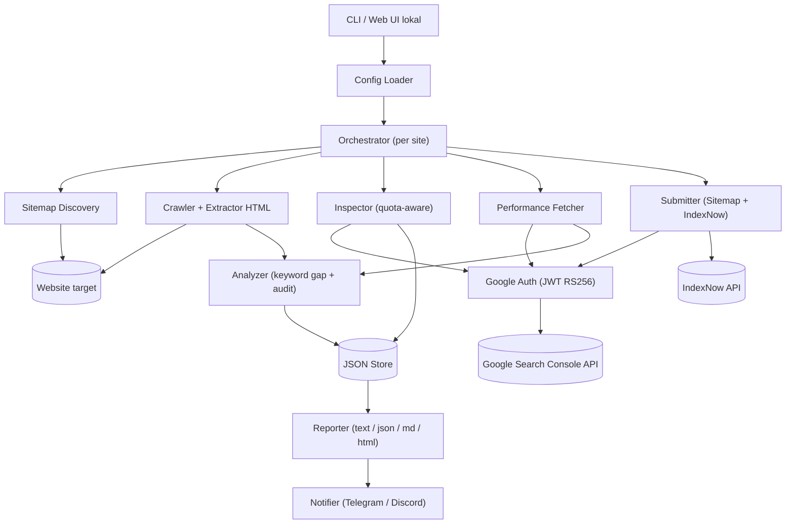
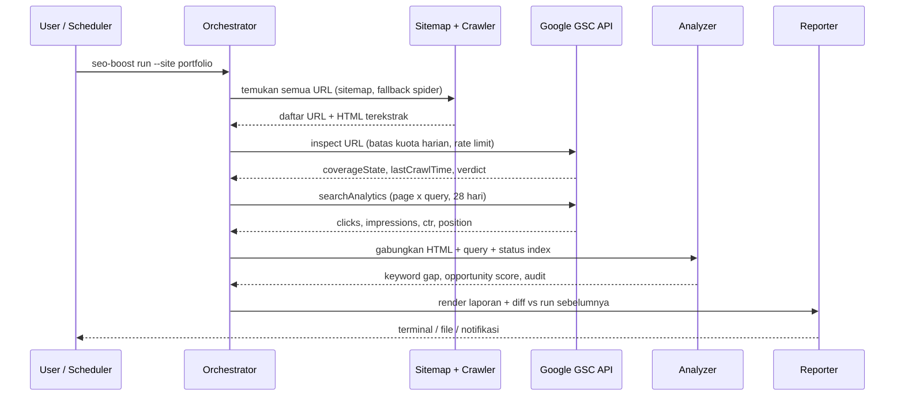

# SEO Automation Tool — Blueprint Pengembangan (Go)

> **Nama kode:** `seo-boost`
> **Stack:** Go (standard library first) · 1 binary · CLI dulu, Web UI lokal menyusul
> **Prinsip:** *Ponytail* — bangun versi paling tipis yang benar-benar jalan. Tanpa framework, tanpa ORM, tanpa dependency yang bisa dihindari.
> **Biaya:** Rp 0. Tanpa trial, tanpa kartu kredit, tanpa langganan.

---

## Daftar Isi

0. [Ringkasan Eksekutif](#0-ringkasan-eksekutif)
1. [Tujuan, Non-Goals, dan Batasan Jujur](#1-tujuan-non-goals-dan-batasan-jujur)
2. [Prasyarat & Setup Google (Gratis)](#2-prasyarat--setup-google-gratis)
3. [Arsitektur](#3-arsitektur)
4. [Keputusan Stack & Dependency](#4-keputusan-stack--dependency)
5. [Struktur Project](#5-struktur-project)
6. [Spesifikasi CLI](#6-spesifikasi-cli)
7. [Konfigurasi](#7-konfigurasi)
8. [Data Model & Penyimpanan](#8-data-model--penyimpanan)
9. [Spesifikasi Modul (Detail)](#9-spesifikasi-modul-detail)
10. [Contoh Output](#10-contoh-output)
11. [Keamanan](#11-keamanan)
12. [Strategi Testing](#12-strategi-testing)
13. [Build & Distribusi](#13-build--distribusi)
14. [Otomasi / Scheduling](#14-otomasi--scheduling)
15. [Roadmap & Checklist per Fase](#15-roadmap--checklist-per-fase)
16. [Ponytail Debt Ledger](#16-ponytail-debt-ledger)
17. [Troubleshooting & FAQ](#17-troubleshooting--faq)
18. [Lampiran: Referensi API](#18-lampiran-referensi-api)

---

## 0. Ringkasan Eksekutif

`seo-boost` adalah tool **eksternal** (berjalan di luar website) yang menjawab 4 pertanyaan SEO, memakai **data resmi Google Search Console (GSC)**:

| # | Pertanyaan | Sumber data | Endpoint |
|---|-----------|-------------|----------|
| 1 | Apakah semua halaman sudah **di-crawl** Google? | GSC URL Inspection API | `urlInspection/index:inspect` |
| 2 | Apakah halaman sudah **ter-index**? | GSC URL Inspection API | `urlInspection/index:inspect` |
| 3 | Apakah **tayang di halaman 1** Google, dan di kata kunci apa? | GSC Search Analytics API | `searchAnalytics/query` |
| 4 | Kata pencarian mana yang **belum ada di teks halaman**? | Search Analytics + crawler HTML sendiri | gabungan |

Karena hanya bergantung pada **URL + HTML + `sitemap.xml`**, tool ini **universal**: Laravel, Next.js, Go, Python, HTML statis, WordPress, semuanya sama di mata tool.

**Target akhir:** satu file `seo-boost` (atau `seo-boost.exe`), kira-kira 8–12 MB, RAM sekitar 15–30 MB saat crawl, siap dicopy ke laptop, VPS, atau CI.

---

## 1. Tujuan, Non-Goals, dan Batasan Jujur

### 1.1 Tujuan (In Scope)

- Multi-site dalam satu konfigurasi.
- Menemukan semua URL (dari `sitemap.xml`, sitemap index, atau spidering internal link).
- Status crawl dan index per URL, dengan riwayat perubahan.
- Performa pencarian per halaman dan per query: clicks, impressions, CTR, posisi.
- Penanda "tayang di halaman 1" (posisi rata-rata ≤ 10).
- Analisis kesenjangan kata kunci (*keyword gap*) antara query Google dan isi halaman.
- Audit SEO on-page dasar: title, meta description, H1, canonical, robots meta, JSON-LD, alt gambar.
- Submit sitemap otomatis dan ping IndexNow (Bing/Yandex dkk).
- Laporan: terminal, JSON, Markdown, HTML.

### 1.2 Non-Goals (Sengaja TIDAK Dibuat)

| Tidak dibuat | Alasan |
|---|---|
| Scraping halaman hasil Google (SERP) | Melanggar ToS Google, kena CAPTCHA, tidak stabil. Posisi dari GSC sudah resmi. |
| Google Indexing API **sebagai fitur default** | Resminya hanya untuk `JobPosting` dan `BroadcastEvent`. Untuk blog biasa **tidak didukung resmi** dan efeknya tidak terjamin. Tersedia sebagai fitur **opt-in** yang mati secara default (lihat 9.7.3). |
| Cek ranking untuk situs milik orang lain | GSC hanya memberi data untuk properti yang **kamu miliki / punya akses**. |
| Backlink / domain authority | Butuh data berbayar (Ahrefs/Semrush). Tidak gratis. |
| Rendering JavaScript (headless browser) | Menambah dependency berat. Lihat [Debt Ledger](#16-ponytail-debt-ledger). |
| Database server / ORM | File JSON sudah cukup untuk skala portofolio dan blog. |

### 1.3 Batasan Data yang HARUS Dipahami

> [!IMPORTANT]
> Bagian ini menentukan kejujuran laporan. Jangan dilewati.

| Hal | Kenyataan |
|---|---|
| **"Posisi" bukan posisi pasti** | `position` di GSC adalah **rata-rata** posisi di semua impresi (beda lokasi, perangkat, waktu). Posisi 4.5 berarti rata-rata, bukan "selalu #4". "Halaman 1" = `position ≤ 10` adalah **pendekatan**. |
| **Data GSC tertunda** | Biasanya 2–3 hari. Data hari ini belum ada. Riwayat maksimal **16 bulan**. |
| **Query dianonimkan** | Query yang sangat jarang (privasi) tidak muncul. Total klik per query bisa kurang dari total klik halaman. |
| **Kuota URL Inspection** | **2.000 URL/hari/properti** dan **600 request/menit/properti**. Situs besar harus dirotasi (ada penjadwal kuota, lihat 9.4). |
| **URL Inspection = status terindeks, bukan "request indexing"** | URL Inspection API hanya **membaca** status. Tombol "Request Indexing" di UI GSC **tidak punya API**. Plugin WordPress juga tidak memakai tombol itu; mereka memakai Google Indexing API (lihat 9.7.3). |
| **"Request indexing" tidak menjamin ter-index** | Baik tombol di GSC maupun Indexing API hanya meminta Google **mengunjungi (crawl)** URL. Apakah URL lalu di-index tetap bergantung pada kualitas konten. |
| **`coverageState` adalah teks bebas** | Teks seperti `"Crawled - currently not indexed"` bisa berubah wording. Tool memetakan berdasarkan `verdict` dulu, lalu pencocokan teks, lalu fallback tampilkan teks mentah. |
| **IndexNow tidak mencakup Google** | IndexNow didukung Bing, Yandex, Naver, Seznam, dkk. **Google tidak ikut.** Untuk Google, cara resminya adalah sitemap dan internal link yang baik. |
| **IndexNow butuh file kunci di situs** | File `https://domain/<key>.txt` harus bisa diakses publik. Ini satu-satunya "sentuhan" ke website. |
| **Crawler kita ≠ Googlebot** | Kita mengambil HTML mentah. Halaman yang isinya dirender JS (SPA) akan terlihat tipis di crawler kita walau Google bisa merendernya. Tool memberi peringatan. |
| **Rekomendasi kata ≠ jaminan ranking** | "Kata bocor" adalah **peluang berbasis data**, bukan jaminan naik peringkat. |

---

## 2. Prasyarat & Setup Google (Gratis)

### 2.1 Software

| Kebutuhan | Versi | Catatan |
|---|---|---|
| Go | **1.22+** | Butuh `net/http` routing pattern baru, `log/slog`, `embed`. Unduh di https://go.dev/dl/ |
| Git | bebas | Opsional |
| Akun Google | bebas | Yang sama dengan pemilik GSC |

Cek instalasi:

```powershell
go version     # harus go1.22 atau lebih baru
```

### 2.2 Setup Google Cloud (tanpa billing)

> [!NOTE]
> Search Console API **gratis dan tidak memerlukan billing aktif**. Jangan klik "Activate / Upgrade" kalau Google menawarkan trial. Itu tidak diperlukan.

1. Buka https://console.cloud.google.com/ lalu **New Project** (misal: `seo-boost`).
2. Menu **APIs & Services → Library** → cari **"Google Search Console API"** → **Enable**.
3. Menu **APIs & Services → Credentials → Create Credentials → Service account**.
   - Nama: `seo-boost-bot`. Role: **kosongkan** (tidak perlu role GCP).
4. Buka service account yang baru dibuat → tab **Keys → Add key → Create new key → JSON**. File JSON terunduh.
5. Simpan ke `secrets/sa.json` (**jangan commit ke Git**).
6. Catat `client_email` di dalam JSON, bentuknya `seo-boost-bot@seo-boost-123.iam.gserviceaccount.com`.

### 2.3 Beri Akses di Search Console

1. Buka https://search.google.com/search-console → pilih properti.
2. **Settings → Users and permissions → Add user**.
3. Isi `client_email` dari langkah 2.2.
4. Permission:

| Fitur yang ingin dipakai | Permission minimum |
|---|---|
| Hanya baca (inspect + analytics) | **Restricted** |
| Submit sitemap | **Full** (atau Owner) |
| Google Indexing API (opsional, 9.7.3) | **Owner** |

### 2.4 Jenis Properti (PENTING)

| Tipe properti | Format `gsc_property` di config |
|---|---|
| Domain property | `sc-domain:example.com` |
| URL-prefix property | `https://example.com/` (**wajib trailing slash, dan sama persis** dengan yang terdaftar) |

Kesalahan format ini adalah penyebab #1 error `403 / permission`. Perintah `seo-boost doctor` akan memeriksanya.

---

## 3. Arsitektur

### 3.1 Diagram Komponen



### 3.2 Alur Data Satu Kali `seo-boost run`



### 3.3 Prinsip Desain

1. **Satu binary, satu proses.** Tanpa daemon bawaan. Penjadwalan diserahkan ke Task Scheduler, cron, atau GitHub Actions.
2. **Stateless kecuali folder `data/`.** Hapus `data/` = mulai dari nol, tidak ada yang rusak.
3. **Fail-soft per URL.** Satu URL error tidak menghentikan seluruh run. Error dicatat di laporan.
4. **Hemat kuota.** Jangan menginspeksi ulang URL yang statusnya baru dicek, kecuali dipaksa (`--force`).
5. **Output deterministik.** Input sama menghasilkan laporan sama (urutan diurutkan), supaya diff antar run bermakna.

---

## 4. Keputusan Stack & Dependency

### 4.1 Pemakaian Standard Library

| Kebutuhan | Paket stdlib | Catatan |
|---|---|---|
| HTTP client / server | `net/http` | Timeout wajib diset manual |
| HTTPS / TLS | `crypto/tls` (otomatis) | Tanpa konfigurasi |
| JSON | `encoding/json` | |
| XML (sitemap) | `encoding/xml` | |
| Sitemap `.gz` | `compress/gzip` | |
| Tanda tangan JWT RS256 | `crypto/rsa`, `crypto/sha256`, `crypto/x509`, `encoding/pem` | Login service account **tanpa library Google** |
| CLI subcommand | `flag` (`flag.NewFlagSet`) | Tanpa cobra |
| Concurrency | goroutine, `sync`, `context` | Worker pool dengan channel |
| Rate limit | `time.Ticker` | Tanpa `x/time/rate` |
| Logging | `log/slog` | |
| Tabel terminal | `text/tabwriter` | |
| Web UI | `embed` + `html/template` + `net/http` | Satu HTML, tanpa framework JS |
| Hash / ID | `crypto/sha256`, `hash/fnv` | |
| Test | `testing`, `net/http/httptest` | |

### 4.2 Satu-satunya Dependency: `golang.org/x/net/html`

> [!WARNING]
> **Koreksi atas klaim sebelumnya:** stdlib Go **tidak memiliki parser HTML**. Jadi "0 dependency mutlak" tidak 100% mungkin kalau kita ingin mengekstrak `<title>`, `<h1>`, `<meta>`, dan `<a href>` dengan benar.

| Opsi | Kelebihan | Kekurangan | Keputusan |
|---|---|---|---|
| **A. `golang.org/x/net/html`** | Dikelola tim Go sendiri. Tokenizer standar HTML5. **Tidak punya dependency turunan** (hanya stdlib dan subpaket `html/atom` dalam modul yang sama). | Tetap kode pihak luar (pernah ada CVE, misalnya `CVE-2023-3978`, `CVE-2024-45338`). | **DIPILIH** |
| B. Regex di stdlib | 0 dependency | Rapuh pada HTML tidak valid, atribut multi-baris, komentar, `<script>`. | Hanya fallback darurat |
| C. `goquery` / `colly` | Enak dipakai | Menarik `cascadia`, `net/html`, dll. Melanggar semangat Ponytail. | Ditolak |

**Mitigasi risiko untuk opsi A:**

1. **Pin versi** dan commit `go.sum`.
2. **`go mod vendor`** supaya build tidak bergantung pada jaringan, dan kode terlihat saat code review.
3. Jalankan **`govulncheck ./...`** sebelum rilis dan di CI (alat resmi tim Go, tidak masuk ke binary).
4. Update `x/net` setiap ada advisory.

```powershell
go install golang.org/x/vuln/cmd/govulncheck@latest
govulncheck ./...
```

> `// ponytail:` Memakai `x/net/html` karena stdlib tak punya parser HTML. Batas: satu dependency. Jalur upgrade/keluar: tulis tokenizer mini sendiri (~150 baris) bila ingin 0 dependency.

### 4.3 Perbandingan Stack Final (untuk Dokumentasi)

| Aspek | Go (dipilih) | Python stdlib | Deno | Rust |
|---|---|---|---|---|
| RAM | ~15–30 MB | ~30–45 MB | ~60–90 MB | ~5–15 MB |
| Dependency wajib | 1 (`x/net/html`) | 0–1 | 0 | puluhan–ratusan crate |
| Distribusi | 1 binary | Perlu interpreter | Perlu runtime/compile | 1 binary |
| RSA-sign bawaan | Ya | Tidak | Ya (WebCrypto) | Tidak |
| Parser HTML bawaan | Tidak | Ya | Tidak | Tidak |
| Concurrency | Sangat mudah | Sedang | Mudah | Sulit (async) |

---

## 5. Struktur Project

Struktur **per-paket** (`cmd/` + `internal/`) dipilih sejak awal supaya kode mudah dikelola: satu folder = satu tanggung jawab, dan tidak ada puluhan file `.go` menumpuk di root. Paket dibuat **saat fasenya tiba**, bukan sekaligus.

```
seo-boost/                       # root = module `seo-boost`
├─ go.mod
├─ go.sum
├─ vendor/                       # hasil `go mod vendor` (dibuat di Fase 1B)
├─ README.md
├─ config.example.json
├─ .gitignore                    # secrets/, data/, config.json, *.exe, dist/
│
├─ cmd/
│  └─ seo-boost/
│     └─ main.go                 # tipis: panggil cli.Run
│
├─ internal/
│  ├─ cli/                       # dispatch subcommand, flag global, slog
│  ├─ config/                    # load + validasi config
│  ├─ model/                     # tipe bersama bagian 8 (Page, IndexInfo, ...)
│  ├─ google/                    # auth JWT + helper HTTP (doJSON) ke Google API
│  ├─ gsc/                       # inspect, searchAnalytics, sitemaps, sites.list
│  ├─ sitemap/                   # parse sitemap/sitemap index/.gz
│  ├─ crawl/                     # fetch halaman + worker pool + spider
│  ├─ extract/                   # ekstrak title/meta/h1-h3/teks/link/jsonld (x/net/html)
│  ├─ inspect/                   # penjadwal kuota + klasifikasi status index
│  ├─ analyze/                   # tokenizer, keyword gap, opportunity
│  ├─ indexnow/                  # ping IndexNow
│  ├─ store/                     # baca/tulis JSON atomik + riwayat
│  ├─ report/                    # renderer text/json/md/html + diff
│  ├─ serve/                     # Web UI lokal (Fase 3)
│  │  └─ web/index.html          # template UI (di-embed; harus di dalam paket serve)
│  └─ notify/                    # Telegram/Discord webhook (Fase 3)
│
├─ scripts/
│  └─ gate.ps1                   # Gate Standar: build, vet, test (+ -race, -vuln)
├─ docs/                         # blueprint, roadmap, PDF
└─ .github/workflows/seo.yml     # contoh otomasi (opsional)
```

Aturan:
- Test berada di samping kodenya (`*_test.go` dalam folder paket yang sama); fixture di `testdata/` milik paket itu.
- `internal/model` hanya berisi tipe, tanpa logika, supaya paket lain tidak saling import melingkar.
- Arah import: `cli` → paket fitur → `model`/`google`. Paket fitur tidak mengimpor `cli`.
- `go:embed` tidak bisa menunjuk folder induk, karena itu `web/` berada di dalam `internal/serve/`.

---

## 6. Spesifikasi CLI

Format: `seo-boost <perintah> [flag]`

| Perintah | Fungsi | Flag utama |
|---|---|---|
| `doctor` | Cek config, kredensial, akses tiap properti GSC, dan versi Go | `--config` |
| `discover` | Temukan semua URL situs (sitemap, fallback spider) dan tampilkan selisih sitemap vs link internal | `--site`, `--spider`, `--max-pages` |
| `crawl` | Ambil HTML semua URL dan ekstrak data on-page + audit | `--site`, `--concurrency` |
| `inspect` | Cek status crawl/index tiap URL via GSC | `--site`, `--force`, `--limit`, `--only-problems` |
| `perf` | Tarik clicks/impressions/ctr/position | `--site`, `--days`, `--min-impressions` |
| `gap` | Analisis keyword gap (query Google vs teks halaman) | `--site`, `--url`, `--top` |
| `submit` | Submit sitemap ke GSC, ping IndexNow, dan (opsional) Google Indexing API | `--site`, `--indexnow`, `--gsc`, `--google-indexing` |
| `run` | Gabungan: discover → crawl → inspect → perf → gap → report | `--site`, `--format`, `--out`, `--notify` |
| `report` | Render ulang laporan dari data tersimpan (tanpa panggil API) | `--site`, `--format`, `--diff` |
| `serve` | Web UI lokal | `--addr` (default `127.0.0.1:8080`) |
| `version` | Tampilkan versi | |

### Flag Global

```
--config   path ke config.json (default: ./config.json)
--site     nama site di config ("all" = semua site)
--format   text | json | md | html  (default: text)
--out      tulis laporan ke file
--verbose  log detail (slog level debug)
```

### Exit Code (untuk CI)

| Kode | Arti |
|---|---|
| `0` | Sukses, tidak ada masalah kritis |
| `1` | Error runtime (config salah, jaringan, auth) |
| `2` | Sukses, tetapi ditemukan masalah (mis. ada halaman `Blocked`/`Error`, atau ada halaman penting tidak ter-index). Dapat dipakai `--fail-on-issues` |

---

## 7. Konfigurasi

`config.json` (salin dari `config.example.json`):

```json
{
  "service_account_file": "./secrets/sa.json",
  "data_dir": "./data",

  "defaults": {
    "user_agent": "seo-boost/1.0 (owner-tool; +https://example.com/about)",
    "crawl_concurrency": 5,
    "crawl_delay_ms": 200,
    "crawl_timeout_s": 20,
    "max_pages": 5000,
    "inspect_rpm": 300,
    "inspect_daily_budget": 1800,
    "reinspect_after_days": 7,
    "perf_days": 28,
    "stopwords": ["id", "en"]
  },

  "sites": [
    {
      "name": "portfolio",
      "gsc_property": "sc-domain:example.com",
      "base_url": "https://example.com",
      "sitemaps": ["https://example.com/sitemap.xml"],
      "exclude_paths": ["/admin", "/tag/", "/search"],
      "priority_paths": ["/", "/blog/"],
      "indexnow_key": ""
    }
  ],

  "notify": {
    "telegram_token_env": "SEOBOOST_TG_TOKEN",
    "telegram_chat_id": "",
    "discord_webhook_env": "SEOBOOST_DISCORD"
  }
}
```

### Aturan Validasi (`config.go`)

| Field | Aturan |
|---|---|
| `service_account_file` | File ada, JSON valid, punya `client_email`, `private_key`, `token_uri` |
| `sites[].name` | Unik, hanya `[a-z0-9-_]` (dipakai jadi nama folder) |
| `gsc_property` | Diawali `sc-domain:` atau `http(s)://` + berakhiran `/` |
| `base_url` | Skema http/https, tanpa path |
| `inspect_daily_budget` | ≤ 2000 (batas Google). Default sengaja 1800 untuk sisa ruang manual |
| `inspect_rpm` | ≤ 600 |
| Secret (token) | **Hanya via env var**, tidak boleh langsung di file config |

---

## 8. Data Model & Penyimpanan

### 8.1 Tipe Utama

```go
// Status index yang sudah dinormalisasi (dipetakan dari verdict + coverageState).
type IndexStatus string

const (
	StatusIndexed              IndexStatus = "indexed"
	StatusCrawledNotIndexed    IndexStatus = "crawled_not_indexed"
	StatusDiscoveredNotIndexed IndexStatus = "discovered_not_indexed"
	StatusUnknownToGoogle      IndexStatus = "unknown_to_google"
	StatusBlocked              IndexStatus = "blocked"    // robots.txt / noindex
	StatusError                IndexStatus = "error"      // 404 / 5xx / soft 404 / redirect error
	StatusDuplicate            IndexStatus = "duplicate"  // canonical lain dipilih
	StatusOther                IndexStatus = "other"      // tampilkan RawCoverage
	StatusNeverInspected       IndexStatus = "never_inspected"
)

type Page struct {
	URL        string    `json:"url"`
	Path       string    `json:"path"`
	InSitemap  bool      `json:"in_sitemap"`
	InternalIn int       `json:"internal_links_in"` // jumlah link internal yang menunjuk ke sini
	Crawl      *CrawlInfo   `json:"crawl,omitempty"`
	Index      *IndexInfo   `json:"index,omitempty"`
	Perf       *PagePerf    `json:"perf,omitempty"`
	Gaps       []QueryGap   `json:"gaps,omitempty"`
	Audit      []AuditIssue `json:"audit,omitempty"`
}

type CrawlInfo struct {
	FetchedAt   time.Time `json:"fetched_at"`
	HTTPStatus  int       `json:"http_status"`
	FinalURL    string    `json:"final_url"`
	Title       string    `json:"title"`
	MetaDesc    string    `json:"meta_description"`
	Canonical   string    `json:"canonical"`
	RobotsMeta  string    `json:"robots_meta"`
	H1          []string  `json:"h1"`
	H2H3        []string  `json:"h2_h3"`
	WordCount   int       `json:"word_count"`
	ImagesNoAlt int       `json:"images_no_alt"`
	HasJSONLD   bool      `json:"has_jsonld"`
	ThinHTML    bool      `json:"thin_html"` // diduga SPA/JS-rendered
	Zones       Zones     `json:"-"`         // teks per zona, tidak disimpan (hemat ruang)
	Err         string    `json:"error,omitempty"`
}

type IndexInfo struct {
	InspectedAt   time.Time   `json:"inspected_at"`
	Status        IndexStatus `json:"status"`
	Verdict       string      `json:"verdict"`        // PASS / PARTIAL / FAIL / NEUTRAL
	RawCoverage   string      `json:"raw_coverage"`   // coverageState asli dari Google
	LastCrawlTime *time.Time  `json:"last_crawl_time,omitempty"`
	CrawledAs     string      `json:"crawled_as"`     // DESKTOP / MOBILE
	PageFetch     string      `json:"page_fetch_state"`
	RobotsTxt     string      `json:"robots_txt_state"`
	IndexingState string      `json:"indexing_state"`
	GoogleCanon   string      `json:"google_canonical"`
	UserCanon     string      `json:"user_canonical"`
}

type PagePerf struct {
	Clicks      float64 `json:"clicks"`
	Impressions float64 `json:"impressions"`
	CTR         float64 `json:"ctr"`
	Position    float64 `json:"position"` // rata-rata
	Page1       bool    `json:"page1"`    // position <= 10 (pendekatan)
	Queries     []QueryPerf `json:"queries"`
}

type QueryPerf struct {
	Query       string  `json:"query"`
	Clicks      float64 `json:"clicks"`
	Impressions float64 `json:"impressions"`
	CTR         float64 `json:"ctr"`
	Position    float64 `json:"position"`
}

type MatchLevel string

const (
	MatchExact   MatchLevel = "exact"     // frasa utuh ada di teks
	MatchAllWord MatchLevel = "all_words" // semua kata ada tapi tidak berurutan
	MatchPartial MatchLevel = "partial"   // sebagian kata hilang
	MatchAbsent  MatchLevel = "absent"    // tidak ada sama sekali
)

type QueryGap struct {
	QueryPerf
	Match      MatchLevel `json:"match"`
	FoundIn    []string   `json:"found_in"`    // title, h1, h2h3, meta, body, url, alt
	MissingTok []string   `json:"missing_tokens"`
	Score      float64    `json:"opportunity_score"`
}

type AuditIssue struct {
	Code     string `json:"code"`     // contoh: title_too_long
	Severity string `json:"severity"` // error | warn | info
	Detail   string `json:"detail"`
}
```

### 8.2 Layout Folder `data/`

```
data/
└─ <site-name>/
   ├─ pages.json                 # snapshot terbaru: []Page (gabungan semua modul)
   ├─ inspections.json           # cache hasil inspect per URL (untuk hemat kuota)
   ├─ quota.json                 # { "date": "2026-10-25", "used": 412 }
   ├─ perf/
   │   └─ 2026-10-25.json        # snapshot performa per hari run
   └─ runs/
       └─ 2026-10-25T18-00-00.json   # ringkasan run (untuk diff)
```

### 8.3 Aturan Penyimpanan

- **Tulis atomik:** tulis ke `file.tmp` → `os.Rename`. Mencegah file korup bila proses mati di tengah jalan.
- Setiap JSON diberi field `"schema": 1` untuk migrasi di masa depan.
- Riwayat `runs/` dipangkas otomatis (default simpan 90 run terakhir).
- Satu proses per site pada satu waktu: pakai **lockfile** `data/<site>/.lock` (`os.OpenFile` dengan `O_EXCL`).

> `// ponytail:` Penyimpanan berupa file JSON. Batas: lambat bila > ~50.000 URL atau perlu query ad-hoc. Jalur upgrade: SQLite (`modernc.org/sqlite`, tanpa CGO), `store.go` sudah dibungkus interface kecil.

---

## 9. Spesifikasi Modul (Detail)

> Nama file di judul bagian ini (mis. `google.go`) adalah nama logis. Lokasi sebenarnya mengikuti bagian 5: `google.go` → `internal/google/`, `crawl.go` → `internal/crawl/`, dan seterusnya (paket `internal/<nama>/`).

### 9.1 Google Auth (`google.go`)

Alur **Service Account → JWT → Access Token** tanpa library Google.

```
1. Baca sa.json → client_email, private_key (PEM PKCS#8), token_uri
2. Bangun header   : {"alg":"RS256","typ":"JWT"}
3. Bangun claim    : iss=client_email, scope=<scope>, aud=token_uri, iat=now, exp=now+1h
4. Tanda tangan    : RSASSA-PKCS1-v1_5 SHA-256 atas  base64url(header).base64url(claim)
5. POST ke token_uri (form):
      grant_type = urn:ietf:params:oauth:grant-type:jwt-bearer
      assertion  = <jwt>
6. Terima {access_token, expires_in}; cache di memori, refresh 60 detik sebelum habis
```

**Scope (prinsip hak minimum):**

| Perintah | Scope |
|---|---|
| `inspect`, `perf`, `doctor` | `https://www.googleapis.com/auth/webmasters.readonly` |
| `submit --gsc` | `https://www.googleapis.com/auth/webmasters` |
| `submit --google-indexing` | `https://www.googleapis.com/auth/indexing` |

Rangka kode (referensi, belum diuji kompilasi):

```go
type saKey struct {
	ClientEmail string `json:"client_email"`
	PrivateKey  string `json:"private_key"`
	TokenURI    string `json:"token_uri"`
}

type googleClient struct {
	sa    saKey
	http  *http.Client // Timeout wajib, mis. 30s
	mu    sync.Mutex
	cache map[string]cachedToken // key = scope
}

type cachedToken struct {
	val string
	exp time.Time
}

var b64 = base64.RawURLEncoding

func (g *googleClient) token(ctx context.Context, scope string) (string, error) {
	g.mu.Lock()
	defer g.mu.Unlock()
	if t, ok := g.cache[scope]; ok && time.Until(t.exp) > time.Minute {
		return t.val, nil
	}

	now := time.Now()
	claims, _ := json.Marshal(map[string]any{
		"iss": g.sa.ClientEmail, "scope": scope, "aud": g.sa.TokenURI,
		"iat": now.Unix(), "exp": now.Add(time.Hour).Unix(),
	})
	unsigned := b64.EncodeToString([]byte(`{"alg":"RS256","typ":"JWT"}`)) + "." + b64.EncodeToString(claims)

	block, _ := pem.Decode([]byte(g.sa.PrivateKey))
	if block == nil {
		return "", errors.New("private_key bukan PEM valid")
	}
	k, err := x509.ParsePKCS8PrivateKey(block.Bytes)
	if err != nil {
		return "", err
	}
	rsaKey, ok := k.(*rsa.PrivateKey)
	if !ok {
		return "", errors.New("private_key bukan RSA")
	}
	sum := sha256.Sum256([]byte(unsigned))
	sig, err := rsa.SignPKCS1v15(rand.Reader, rsaKey, crypto.SHA256, sum[:])
	if err != nil {
		return "", err
	}
	assertion := unsigned + "." + b64.EncodeToString(sig)

	form := url.Values{
		"grant_type": {"urn:ietf:params:oauth:grant-type:jwt-bearer"},
		"assertion":  {assertion},
	}
	req, _ := http.NewRequestWithContext(ctx, "POST", g.sa.TokenURI, strings.NewReader(form.Encode()))
	req.Header.Set("Content-Type", "application/x-www-form-urlencoded")
	resp, err := g.http.Do(req)
	if err != nil {
		return "", err
	}
	defer resp.Body.Close()
	var out struct {
		AccessToken string `json:"access_token"`
		ExpiresIn   int    `json:"expires_in"`
		Error       string `json:"error_description"`
	}
	if err := json.NewDecoder(resp.Body).Decode(&out); err != nil {
		return "", err
	}
	if out.AccessToken == "" {
		return "", fmt.Errorf("token gagal: %s", out.Error)
	}
	g.cache[scope] = cachedToken{out.AccessToken, now.Add(time.Duration(out.ExpiresIn) * time.Second)}
	return out.AccessToken, nil
}
```

**Helper request** (`doJSON`): set header `Authorization: Bearer`, retry dengan *exponential backoff + jitter* untuk status `429` dan `5xx` (maks 4x), hormati `Retry-After`, dan **jangan pernah** me-log header Authorization.

---

### 9.2 Sitemap Discovery (`sitemap.go`)

**Input:** daftar URL sitemap. **Output:** himpunan URL unik.

| Aturan | Detail |
|---|---|
| Sitemap index | Jika root `<sitemapindex>`, ambil semua `<sitemap><loc>` secara rekursif (maks kedalaman 3) |
| Kompresi | Deteksi `.gz` atau header `Content-Encoding`; pakai `compress/gzip` |
| Normalisasi URL | Hapus fragment `#...`, lowercase host, buang `:80`/`:443` default, urutkan |
| Filter | Hanya host yang sama dengan `base_url`. Terapkan `exclude_paths` |
| Batas | Maks 50.000 URL per sitemap (spesifikasi sitemap), total ikut `max_pages` |
| Fallback | Jika sitemap tidak ada/kosong dan `--spider`, jalankan spidering (9.3) |
| Cari otomatis | Jika `sitemaps` kosong: baca `robots.txt` baris `Sitemap:`, lalu coba `/sitemap.xml` dan `/sitemap_index.xml` |

```go
type urlset struct {
	URLs []struct {
		Loc     string `xml:"loc"`
		LastMod string `xml:"lastmod"`
	} `xml:"url"`
}
type sitemapIndex struct {
	Sitemaps []struct {
		Loc string `xml:"loc"`
	} `xml:"sitemap"`
}
```

**Fitur selisih (sitemap vs link internal)** setelah crawl:

| Kondisi | Arti | Tindakan |
|---|---|---|
| Ada di sitemap, **tidak** ada link internal masuk (`InternalIn == 0`) | **Orphan page** | Tambahkan internal link |
| Ada link internal, **tidak** ada di sitemap | Sitemap tidak lengkap | Tambahkan ke sitemap |
| Ada di sitemap tetapi HTTP ≠ 200 | Sitemap kotor | Hapus / perbaiki |

---

### 9.3 Crawler (`crawl.go`)

Menjawab: *"Apakah semua halaman bisa diakses & dibaca?"*

**Worker pool:**

```
jobs chan string (URL)  →  N worker (crawl_concurrency)  →  results chan CrawlInfo
```

| Aturan | Detail |
|---|---|
| Concurrency | Default 5. Delay antar request per worker `crawl_delay_ms` (sopan ke server sendiri) |
| Timeout | `context.WithTimeout` per request (default 20 s) |
| Redirect | Maks 5. Catat `FinalURL`, dan tandai bila host berubah |
| Ukuran | Batasi body `io.LimitReader` (default 5 MB) |
| Content-Type | Hanya proses `text/html` / `application/xhtml+xml` |
| Header | `User-Agent` dari config, `Accept: text/html`, `Accept-Encoding` ditangani otomatis oleh `net/http` |
| Retry | 1x untuk error jaringan/5xx |
| Robots.txt | **Dihormati** untuk mode spider (hindari path yang tak boleh). Untuk URL sitemap, cukup dicatat bila terblokir |
| Spider | BFS dari `base_url`, ikuti `<a href>` internal saja, maks `max_pages`, deduplikasi URL ternormalisasi |
| Deteksi `ThinHTML` | `WordCount < 50` **dan** ada `<script>` ≥ 3 (atau ada `id="root"`, `id="__next"`, `id="app"` yang hampir kosong) |

**Hasil per URL:** `HTTPStatus`, `FinalURL`, ekstrak (9.3.1), dan daftar link internal untuk menghitung `InternalIn`.

#### 9.3.1 Ekstraksi HTML (`extract.go`)

Lewati isi `<script>`, `<style>`, `<noscript>`, `<template>`.

| Elemen | Disimpan sebagai |
|---|---|
| `<title>` | Zona `title` |
| `<meta name="description">` | Zona `meta` |
| `<link rel="canonical">` | `Canonical` |
| `<meta name="robots">` | `RobotsMeta` (cari `noindex`, `nofollow`) |
| `<h1>` | Zona `h1` |
| `<h2>`, `<h3>` | Zona `h2h3` |
| `<p>`, `<li>`, `<td>`, `<blockquote>`, `<figcaption>` | Zona `body` |
| `` | Zona `alt`; hitung gambar tanpa `alt` (`ImagesNoAlt`) |
| `<script type="application/ld+json">` | `HasJSONLD` (opsional: baca `@type`) |
| `<a href>` | Daftar link (internal/eksternal) |
| Slug URL | Zona `url` (path dipecah per `-`, `_`, `/`) |

```go
type Zones struct {
	Title, Meta, URL string
	H1, H2H3, Body, Alt []string
}
```

#### 9.3.2 Aturan Audit On-Page

| Kode | Severity | Kondisi |
|---|---|---|
| `http_not_200` | error | Status ≠ 200 |
| `noindex_meta` | error | `robots` meta memuat `noindex` |
| `title_missing` | error | Tidak ada `<title>` |
| `title_length` | warn | < 30 atau > 60 karakter |
| `meta_missing` | warn | Tidak ada meta description |
| `meta_length` | warn | < 70 atau > 160 karakter |
| `h1_missing` | error | Tidak ada H1 |
| `h1_multiple` | warn | H1 > 1 |
| `canonical_missing` | warn | Tidak ada canonical |
| `canonical_mismatch` | warn | Canonical ke URL lain (dan bukan dirinya) |
| `images_no_alt` | warn | Ada gambar tanpa `alt` |
| `thin_content` | warn | `WordCount < 300` (blog) |
| `thin_html_spa` | info | `ThinHTML` true (kemungkinan JS-rendered, hasil analisis kata tidak dapat dipercaya) |
| `jsonld_missing` | info | Tidak ada JSON-LD |
| `orphan_page` | warn | Ada di sitemap tapi `InternalIn == 0` |
| `title_duplicate` / `meta_duplicate` | warn | Judul/deskripsi sama dengan halaman lain |

Ambang batas disimpan sebagai konstanta di satu tempat supaya mudah diubah.

---

### 9.4 Inspector (`inspect.go` + `gsc.go`)

Menjawab: *"Apakah di-crawl? Apakah ter-index?"*

**Endpoint**

```
POST https://searchconsole.googleapis.com/v1/urlInspection/index:inspect
Body: {"inspectionUrl":"<url>", "siteUrl":"<gsc_property>", "languageCode":"id-ID"}
```

**Respons (field yang dipakai):** `inspectionResult.indexStatusResult` → `verdict`, `coverageState`, `robotsTxtState`, `indexingState`, `lastCrawlTime`, `pageFetchState`, `googleCanonical`, `userCanonical`, `crawledAs`.

#### Pemetaan Status (urutan prioritas)

| Cek (berurutan) | `IndexStatus` |
|---|---|
| `robotsTxtState == "DISALLOWED"` atau `indexingState` memuat `BLOCKED_*` | `blocked` |
| `pageFetchState` ∈ {`NOT_FOUND`, `SOFT_404`, `SERVER_ERROR`, `REDIRECT_ERROR`, `ACCESS_DENIED`, `ACCESS_FORBIDDEN`, `BLOCKED_4XX`, `INTERNAL_CRAWL_ERROR`, `INVALID_URL`} | `error` |
| `verdict == "PASS"` | `indexed` |
| `coverageState` memuat `"Crawled - currently not indexed"` | `crawled_not_indexed` |
| `coverageState` memuat `"Discovered - currently not indexed"` | `discovered_not_indexed` |
| `coverageState` memuat `"unknown to Google"` | `unknown_to_google` |
| `coverageState` memuat `"Duplicate"` atau `"canonical"` | `duplicate` |
| selain itu | `other` (tampilkan `RawCoverage` apa adanya) |

> Karena `coverageState` adalah teks bebas, `RawCoverage` **selalu disimpan dan ditampilkan** di laporan detail supaya tidak ada informasi yang hilang bila wording berubah.

#### Penjadwal Hemat Kuota

Masalah: situs 1.200 halaman × inspeksi mingguan > kuota 2.000/hari bila tidak dirotasi.

**Algoritme pemilihan antrian** (urut prioritas):

1. URL **belum pernah** diinspeksi (`never_inspected`).
2. URL yang cocok `priority_paths` (blog, beranda).
3. URL berstatus **bermasalah** terakhir kali (`crawled_not_indexed`, `discovered_not_indexed`, `unknown_to_google`, `error`), dicek ulang lebih sering.
4. URL `indexed` yang usia inspeksinya > `reinspect_after_days`.
5. Sisanya, yang paling lama tidak dicek.

Potong sampai `min(inspect_daily_budget − quota_terpakai_hari_ini, --limit)`.

**Rate limit:** `time.Ticker` dengan interval `60s / inspect_rpm` + worker 3–5. Pada `429`, berhenti sementara (backoff) dan **jangan** mencoba lagi sampai interval berikutnya.

**Penghitung kuota:** `quota.json` berisi `{date, used}` (tanggal zona **Pacific Time**, karena kuota Google reset mengikuti hari Pacific). Di-increment per request sukses/gagal yang menghabiskan kuota.

> `// ponytail:` Kuota dilacak lokal di `quota.json`. Batas: tidak tahu bila Anda juga memakai kuota dari tool lain pada properti yang sama. Jalur upgrade: baca header kuota/error `429` sebagai sumber kebenaran (sudah ada fallback: berhenti saat `429`).

---

### 9.5 Performance Fetcher (`gsc.go`)

Menjawab: *"Tayang di halaman 1? Kata apa? Berapa klik?"*

**Endpoint**

```
POST https://www.googleapis.com/webmasters/v3/sites/{urlencode(gsc_property)}/searchAnalytics/query
Body:
{
  "startDate": "YYYY-MM-DD",
  "endDate":   "YYYY-MM-DD",
  "dimensions": ["page","query"],
  "rowLimit": 25000,
  "startRow": 0,
  "dataState": "final"
}
```

| Aturan | Detail |
|---|---|
| Rentang tanggal | `endDate = hari ini − 3` (data final tertunda), `startDate = endDate − perf_days + 1` |
| Paginasi | Ulangi dengan `startRow += 25000` sampai baris < `rowLimit` |
| Urut respons | Google mengurutkan berdasarkan clicks menurun |
| Format kunci | `keys[0]` = URL halaman, `keys[1]` = query |
| Agregasi per halaman | Hitung dari baris `page×query`: `clicks`, `impressions` dijumlahkan; `position` = **rata-rata berbobot impresi**; `ctr = clicks/impressions` |
| `Page1` | `position_page ≤ 10.0` (pendekatan; tampilkan angka aslinya) |
| Pencocokan URL | Normalisasi sama seperti 9.2 (trailing slash, fragment) supaya `Page` bisa digabung |
| Kueri anonim | Dicatat di laporan sebagai catatan: *"query dengan volume sangat kecil tidak ditampilkan Google"* |

**Perbandingan periode (opsional, murah):** jalankan 2 kali (periode sekarang vs sebelumnya) → tampilkan delta clicks/impressions/posisi per halaman (`▲ ▼`).

```go
type saRow struct {
	Keys        []string `json:"keys"`
	Clicks      float64  `json:"clicks"`
	Impressions float64  `json:"impressions"`
	CTR         float64  `json:"ctr"`
	Position    float64  `json:"position"`
}
```

---

### 9.6 Keyword Gap Analyzer (`analyze.go`)

Menjawab: *"Kata yang diketik orang di Google, ada di teks halamanmu atau tidak?"*

#### Normalisasi

1. Lowercase (`strings.ToLower`).
2. Pisah token dengan `strings.FieldsFunc(s, func(r rune) bool { return !unicode.IsLetter(r) && !unicode.IsDigit(r) })`.
3. Buang token 1 karakter.
4. Stopword **tidak dihitung sebagai kata hilang**, tapi tetap dipakai untuk pencocokan frasa. Daftar kecil di-embed (ID: `yang, di, ke, dari, dan, atau, untuk, dengan, pada, ini, itu, adalah, cara`; EN: `the, a, an, of, to, in, for, and, or, is, how`).

#### Level Pencocokan (per query vs satu halaman)

| Level | Syarat | Arti |
|---|---|---|
| `exact` | Frasa query (token berurutan) ditemukan di salah satu zona | Halaman sudah memuat frasa persis |
| `all_words` | Semua token non-stopword ada di halaman, tetapi tersebar | Kata ada, frasa belum berbentuk utuh |
| `partial` | Sebagian token ada. Token yang hilang disimpan di `MissingTok` | Tambah kata yang hilang |
| `absent` | Tidak ada token non-stopword yang ditemukan | Google mengaitkan halaman lewat sinyal lain |

Pencarian frasa: gabungkan token tiap zona dengan spasi, lalu cek `strings.Contains(" "+zoneText+" ", " "+queryNorm+" ")`.

`FoundIn` mencatat zona mana saja yang memuat (urutan kekuatan: `title` > `h1` > `h2h3` > `meta` > `url` > `body` > `alt`).

#### Skor Peluang (Opportunity Score)

Heuristik sederhana, bukan sihir. Konstanta dapat diubah di satu tempat.

```
expectedCTR(pos) ≈ {1:0.28, 2:0.15, 3:0.11, 4:0.08, 5:0.07, 6:0.05, 7:0.04, 8:0.035, 9:0.03, 10:0.025, 11-20:0.01, >20:0.003}

potensiKlik = impressions × max(0, expectedCTR(posisi_target) − ctr_aktual)

score = potensiKlik × bobotMatch
bobotMatch: absent=1.0 | partial=0.9 | all_words=0.6 | exact=0.3
```

Dengan `posisi_target = max(1, posisi − 3)` (andaikan naik 3 peringkat).

**Kategori hasil:**

| Kategori | Kriteria | Tindakan yang disarankan |
|---|---|---|
| ⚡ **Low-hanging fruit** | posisi 5–20, impresi tinggi (≥ `--min-impressions`), `match` ≠ `exact` | Sisipkan frasa di H1/H2/paragraf pertama |
| 🎯 **Title/Meta fix** | posisi ≤ 10, CTR jauh di bawah `expectedCTR` | Perbaiki judul dan meta description |
| ✅ **Sudah kuat** | posisi ≤ 10 dan `match == exact` | Pertahankan |
| 🔎 **Konten belum menjawab** | `absent`, impresi besar | Pertimbangkan section / artikel baru |

> `// ponytail:` Pencocokan kata memakai kecocokan harfiah (tanpa stemming). Batas: "membuat" ≠ "buat", "running" ≠ "run". Jalur upgrade: suffix stripper kecil untuk Indonesia/Inggris (~80 baris) atau stemmer Porter.

---

### 9.7 Submitter (`gsc.go`, `indexnow.go`)

#### 9.7.1 Sitemap ke GSC

```
PUT  https://www.googleapis.com/webmasters/v3/sites/{site}/sitemaps/{feedpath}
GET  https://www.googleapis.com/webmasters/v3/sites                          # doctor: cek akses
GET  https://www.googleapis.com/webmasters/v3/sites/{site}/sitemaps          # status sitemap
```

(`{site}` dan `{feedpath}` di-**URL-encode** penuh.) Sukses = `204`/`200`.

`seo-boost submit --gsc` mengirim ulang sitemap. Tool juga membaca `sitemaps.list` untuk menampilkan: `lastDownloaded`, `isPending`, `errors`, `warnings`, jumlah URL yang dikirim vs ter-index (jika tersedia).

> Pengiriman ulang sitemap itu **sinyal**, bukan perintah. Google tetap menjadwalkan crawl sendiri. Yang berpengaruh nyata: `<lastmod>` akurat di sitemap dan internal link yang baik.

#### 9.7.2 IndexNow (Bing, Yandex, dkk. — bukan Google)

```
POST https://api.indexnow.org/indexnow
Content-Type: application/json
{
  "host": "example.com",
  "key": "<indexnow_key>",
  "keyLocation": "https://example.com/<indexnow_key>.txt",
  "urlList": ["https://example.com/blog/artikel-baru", "..."]
}
```

| Aturan | Detail |
|---|---|
| Kunci | Hex 8–128 karakter. Perintah `seo-boost indexnow-key` membuat kunci acak (`crypto/rand`) dan mencetak isi file yang harus ditaruh di `https://domain/<key>.txt` |
| Batas | Maks 10.000 URL per request |
| URL yang dikirim | Hanya URL **baru/berubah** sejak run terakhir (bandingkan `lastmod` atau hash konten dari `store`) |
| Validasi | Sebelum submit, tool memeriksa file kunci bisa diakses (`GET keyLocation` harus mengembalikan isi = kunci). Gagal = batalkan dan beri pesan jelas |
| Respons | `200`/`202` = diterima. `422`/`403` = kunci tidak valid |

---

#### 9.7.3 Google Indexing API (OPSIONAL, mati secara default)

Inilah yang sebenarnya dipakai fitur "Instant Indexing" di plugin WordPress seperti Rank Math. Pengguna plugin tidak membuka GSC karena plugin memanggil API ini lewat service account.

> [!WARNING]
> **Status resmi:** Google menyatakan Indexing API hanya untuk halaman `JobPosting` dan `BroadcastEvent` (livestream). Untuk blog/portofolio biasa, ini **di luar penggunaan yang didukung**. API tetap menerima request (tidak ditolak secara teknis), tetapi:
> - Google tidak menjanjikan URL akan dicrawl cepat atau di-index.
> - Bukti efektivitas untuk konten biasa hanya laporan komunitas dan hasilnya campuran, bukan data resmi.
> - Google bisa membatasi atau menghentikan perilaku ini kapan saja tanpa pemberitahuan.
> - Tidak ada dokumentasi resmi soal hukuman, tetapi memakainya di luar peruntukan adalah risiko kebijakan yang kamu tanggung sendiri.
>
> Karena itu fitur ini **opt-in**: tidak jalan kecuali diaktifkan eksplisit.

**Endpoint**

```
POST https://indexing.googleapis.com/v3/urlNotifications:publish
Body: {"url": "https://example.com/blog/artikel-baru", "type": "URL_UPDATED"}   # atau URL_DELETED
GET  https://indexing.googleapis.com/v3/urlNotifications/metadata?url=<urlencoded>   # status notifikasi terakhir
```

| Aspek | Detail |
|---|---|
| Biaya | Gratis. Tidak butuh billing |
| Setup tambahan | Enable **"Web Search Indexing API"** di project Google Cloud yang sama |
| Scope | `https://www.googleapis.com/auth/indexing` |
| Izin di GSC | Service account harus **Owner** properti (bukan sekadar Full/Restricted) |
| Kuota default | **200 request publish/hari**, 180/menit (bisa dinaikkan lewat form permintaan Google) |
| Batch | Didukung (maks 100 URL/batch), tetapi tiap URL tetap menghabiskan kuota |

**Perilaku tool (aman secara desain):**

1. Aktif hanya jika `"google_indexing": {"enabled": true}` di config **dan** flag `--google-indexing` diberikan. Dua kunci, supaya tidak jalan tanpa sengaja.
2. Tool mencetak peringatan di atas sekali per run dan mencatat di laporan.
3. Hanya kirim URL **baru atau berubah** sejak run terakhir (bandingkan `lastmod` / hash konten). Jangan pernah mengirim seluruh situs.
4. Hanya URL berstatus HTTP 200, tanpa `noindex`, dan bukan duplikat/redirect (hasil crawl sudah tahu).
5. Dibatasi `daily_cap` (default **50**, jauh di bawah kuota 200) dan dilacak di `quota.json`.
6. Hasil `getMetadata` dan status HTTP dicatat per URL. Tool **tidak** mengklaim "sudah ter-index"; status index tetap dikonfirmasi lewat Inspector (9.4) beberapa hari kemudian.
7. Pada `403`, tool berhenti dan menjelaskan: kemungkinan bukan Owner, API belum di-enable, atau Google membatasi akses.

```json
"google_indexing": { "enabled": false, "daily_cap": 50 }
```

> `// ponytail:` Memakai Indexing API di luar peruntukan resmi untuk situs non-loker/non-livestream. Batas: dapat berhenti bekerja atau dibatasi Google kapan saja, dan efeknya tidak terjamin. Jalur aman: sitemap dengan `<lastmod>` akurat + internal link + IndexNow (untuk Bing/Yandex).

**Cara mengukur apakah fitur ini membantu situs kamu** (tanpa asumsi): tool mencatat `selisih waktu` antara URL dikirim ke API dan `lastCrawlTime` pertama yang lebih baru dari waktu kirim (dari Inspector). Setelah beberapa artikel, kamu punya data sendiri: apakah crawl memang lebih cepat dibanding artikel yang tidak dikirim.

---

#### 9.7.4 Mode Agresif Indexing API (`--aggressive`, opsional)

Untuk pengguna yang sudah memahami risiko di 9.7.3 dan ingin memakai Indexing API secara maksimal. Prinsipnya: **pakai kuota 200/hari sepintar mungkin**, bukan menyiram semua URL.

**Perbedaan dengan mode aman:**

| Aspek | Mode aman (9.7.3) | Mode agresif |
|---|---|---|
| Aktivasi | `enabled: true` **dan** `--google-indexing` | Cukup `--google-indexing --aggressive` (tanpa konfirmasi tambahan) |
| `daily_cap` | 50 | Hingga **190** (sisakan 10 untuk manual/`URL_DELETED`) |
| URL yang dikirim | Hanya baru/berubah | Baru/berubah **+ URL macet** (`discovered_not_indexed`, `unknown_to_google`, `crawled_not_indexed`) |
| Pengiriman ulang | Tidak | Ya, dengan cooldown per URL |
| Pemicu | Manual | Otomatis di pipeline deploy dan di akhir `run` |
| `URL_DELETED` | Tidak | Ya, untuk halaman yang dihapus (404/410) |

**Antrian prioritas (diisi hingga `daily_cap`):**

1. URL **baru** (belum pernah dikirim, `unknown_to_google` atau `never_inspected`).
2. URL **konten berubah** sejak pengiriman terakhir (hash teks berbeda).
3. `discovered_not_indexed` (Google tahu tapi belum crawl; yang paling masuk akal didorong).
4. `crawled_not_indexed` **hanya jika kontennya sudah berubah**. Jika tidak berubah, jangan kirim (lihat catatan di bawah).
5. Halaman prioritas (`priority_paths`) yang usia crawl terakhirnya paling lama.
6. `URL_DELETED` untuk halaman yang kini 404/410 tetapi masih `indexed`.

**Pengaman yang tetap ada (demi efisiensi, bukan moral):**

| Aturan | Alasan |
|---|---|
| Cooldown per URL, default **7 hari** (`resubmit_cooldown_days`) | Mengirim URL yang sama berulang tanpa perubahan hampir pasti tidak ada gunanya dan memboroskan kuota |
| Maks **3 pengiriman** per versi konten (hash sama) | Setelah 3x tanpa hasil, masalahnya hampir pasti kualitas/duplikasi, bukan crawl |
| Hanya HTTP 200, tanpa `noindex`, canonical ke diri sendiri | Mengirim URL yang memang tidak boleh di-index = kuota terbuang |
| Berhenti total saat `403` / `429` | Lanjut menembak setelah ditolak hanya memperburuk keadaan |
| `daily_cap` tidak bisa melebihi **kuota Google** (hard-clamp 200) | Tidak ada gunanya, Google yang menolak |
| Laporan selalu mencantumkan **hasil terukur** (selang waktu kirim → crawl berikutnya) | Supaya terlihat apakah mode ini sungguh bekerja untuk situsmu |

```json
"google_indexing": {
  "enabled": true,
  "mode": "aggressive",
  "daily_cap": 190,
  "resubmit_cooldown_days": 7,
  "max_sends_per_content_version": 3,
  "send_deleted": true
}
```

**Alur otomatis (sekali jalan, ideal dipanggil setelah deploy):**

```
seo-boost run --site portfolio --google-indexing --aggressive
  ├─ discover + crawl         → hash konten, deteksi baru/berubah/dihapus
  ├─ inspect (hemat kuota)    → status index terbaru
  ├─ bangun antrian prioritas → potong ke sisa kuota hari ini
  ├─ publish URL_UPDATED / URL_DELETED (3 worker, ≤ 180/menit)
  ├─ catat ke data/<site>/indexing.json  {url, hash, sent_at, http, type}
  └─ laporan: dikirim n, ditolak n, kuota tersisa, selang crawl rata-rata
```

**Hal yang sengaja TIDAK dibuat, meskipun diminta mode agresif:**

- **Memutar banyak project / service account untuk melipatgandakan kuota 200/hari.** Itu menghindari batas yang Google tetapkan. Pelanggarannya jauh lebih jelas daripada sekadar memakai API di luar jenis konten resmi, dan paling mungkin membuat akses dicabut. Jika kuota kurang, jalan yang masuk akal adalah mengajukan kenaikan kuota lewat form resmi Google.
- **Mengirim seluruh situs setiap hari.** Memboroskan kuota tanpa menambah peluang.

**Ekspektasi yang jujur:** Mode ini mempercepat **crawl**, bukan menjamin **index**. Untuk `crawled_not_indexed`, Google sudah mengunjungi halaman itu dan memutuskan tidak mengindeksnya. Mendorong ulang tidak mengubah keputusan itu; yang mengubah adalah kualitas, keunikan, dan internal link ke halaman tersebut. Itu sebabnya halaman jenis ini hanya dikirim ulang setelah kontennya berubah.

---

### 9.8 Reporter (`report.go`)

| Format | Penggunaan |
|---|---|
| `text` | Terminal, pakai `tabwriter`, ikon `✅ ⚠️ ❌ ⚡` (dimatikan otomatis bila bukan TTY / `NO_COLOR`) |
| `json` | Mesin / integrasi / CI |
| `md` | Disimpan, di-commit, atau dikirim ke Notion/issue |
| `html` | Satu file mandiri (CSS inline), bisa dibuka dari mana saja |

**Struktur laporan:**

1. **Ringkasan** (angka): total halaman, ter-index (n/N), bermasalah, tayang halaman 1, total klik/impresi, perubahan vs run sebelumnya.
2. **Tabel status halaman** (urut: bermasalah di atas).
3. **Halaman 1 Google** (halaman, posisi, klik).
4. **Peluang boost** (keyword gap teratas, global dan per halaman).
5. **Audit on-page** (dikelompokkan per severity).
6. **Selisih sitemap vs link internal** (orphan, tidak di sitemap).
7. **Perubahan sejak run terakhir (diff):** halaman baru ter-index, halaman yang turun/hilang dari index, kenaikan/penurunan posisi ≥ 3.
8. **Catatan & batasan data** (otomatis, ringkas, ambil dari bagian 1.3).

**Diff:** bandingkan `runs/<terbaru>` dengan `runs/<sebelumnya>`, kunci = URL. Hanya tampilkan perubahan bermakna.

---

### 9.9 Web UI Lokal (`serve.go`, `web/index.html`) — Phase 3

| Aspek | Keputusan |
|---|---|
| Bind | **`127.0.0.1` saja** secara default |
| Teknologi | `embed` satu `index.html` + `html/template` + sedikit JS vanilla. Tanpa npm, tanpa bundler |
| Auth | Token acak dicetak saat start (`?t=...` / header). Wajib bila `--addr` bukan loopback |
| Endpoint | `GET /` dashboard · `GET /api/sites` · `GET /api/sites/{name}/pages` · `GET /api/sites/{name}/gaps` · `POST /api/sites/{name}/run` · `GET /api/runs/{id}` |
| Run async | Goroutine + status polling (`/api/runs/{id}` mengembalikan progres: n/N URL) |
| Halaman | (1) Ringkasan semua site (2) Tabel halaman dengan filter status (3) Detail halaman: audit + keyword gap (4) Riwayat run & diff |
| Keamanan | Tidak ada endpoint yang menerima URL bebas dari pengguna (mencegah SSRF). Hanya situs di config |

---

### 9.10 Notifier (`notify.go`) — Phase 3

| Kanal | Cara | Biaya |
|---|---|---|
| Telegram | `POST https://api.telegram.org/bot<TOKEN>/sendMessage` (`chat_id`, `text`, `parse_mode`) | Gratis |
| Discord | `POST <webhook_url>` JSON `{"content": "..."}` | Gratis |
| Email | Tidak dibuat (SMTP butuh kredensial; Ponytail: tunda) | – |

Kirim **ringkasan + diff** saja (maks ~1.500 karakter), bukan laporan penuh. Kirim hanya bila ada perubahan bermakna atau `--notify always`.

---

### 9.11 Log Server (Opsional, Phase 4) — Googlebot Crawl Tanpa Kuota

Cara lain menjawab *"apakah Googlebot benar-benar mengunjungi semua halaman?"* tanpa batas 2.000/hari: parsing **access log** (Nginx/Apache/Caddy).

- Baca log (flag `--log path`, format *combined*).
- Filter User-Agent `Googlebot`, lalu **verifikasi** dengan reverse DNS (`net.LookupAddr` harus berakhiran `.googlebot.com` / `.google.com`, lalu forward-lookup harus cocok). UA saja bisa dipalsukan.
- Hasil: tanggal terakhir Googlebot mengunjungi tiap path, frekuensi, dan status HTTP yang diterimanya.
- Hanya tersedia jika kamu punya akses log server (tidak untuk hosting statis seperti GitHub Pages/Vercel).

---

## 10. Contoh Output

```text
═══════════════════════════════════════════════════════════════════
 SEO-BOOST · portfolio (sc-domain:example.com) · 2026-10-25 18:00
═══════════════════════════════════════════════════════════════════
 RINGKASAN
   Halaman ditemukan   : 14   (sitemap: 14 | link internal: 13)
   Ter-index Google    : 12/14
   Bermasalah          : 2    (1 crawled-not-indexed, 1 discovered-not-indexed)
   Tayang di Halaman 1 : 5 halaman (posisi rata-rata ≤ 10)
   28 hari terakhir    : 1.842 klik · 61.240 impresi · CTR 3,0%
   Kuota inspeksi      : 14 terpakai hari ini (sisa 1.786)

 STATUS CRAWL & INDEX
 ✅ /                        indexed  crawl 2 jam lalu   Hal.1 (pos 1,2)   312 klik
 ✅ /blog/belajar-golang     indexed  crawl 3 hari lalu  Hal.1 (pos 4,5)    48 klik
 ⚠️  /blog/tips-docker        crawled - currently not indexed (crawl 5 hari lalu)
 ❌ /project/kalkulator-kpr  discovered - currently not indexed (belum di-crawl)

 DETAIL: /blog/belajar-golang
   Tayang           : 1.420 impresi · 48 klik · CTR 3,4% · pos rata-rata 4,5
   Audit            : ✔ title 54 kar. · ✔ meta 148 kar. · ⚠ 2 gambar tanpa alt
   Query & kecocokan:
    1. "tutorial golang pemula"   pos 3,0  exact      [h1, body]            ✅
    2. "cara install go"          pos 8,2  exact      [h2h3]                ✅
    3. "golang concurrency contoh" pos 12,1 210 impresi  absent  ⚡ PELUANG
         → tambahkan frasa ini di H2 + paragraf penjelasan
    4. "belajar goroutine"         pos 9,4  partial    hilang: [goroutine]   ⚡ PELUANG

 DIFF vs RUN 2026-10-18
   + /blog/panduan-git    baru ter-index
   ▼ /blog/tips-docker    pos 7,1 → 11,4 (turun keluar halaman 1)

 CATATAN: posisi = rata-rata di GSC; data tertunda ±3 hari; query langka tidak ditampilkan.
```

---

## 11. Keamanan

| Risiko | Mitigasi |
|---|---|
| Kebocoran `sa.json` | Folder `secrets/` masuk `.gitignore`. Di Windows, batasi ACL file. Di Linux `chmod 600`. Di CI gunakan *secret* bukan file di repo |
| Secret di config | Token Telegram/Discord hanya via env var |
| Scope berlebih | Default `webmasters.readonly`, scope penuh hanya saat `submit --gsc` |
| Log bocor token | Jangan log header `Authorization` atau isi respons token. Redaksi pada `slog` |
| SSRF di mode `serve` | Tool hanya mengakses host yang ada di config. Tidak ada input URL bebas |
| Web UI terbuka ke jaringan | Default bind `127.0.0.1`. Non-loopback wajib token |
| Crawler membebani situs | Concurrency kecil, delay, hormati robots.txt pada mode spider |
| Kerentanan dependency | Hanya 1 dependency. `go mod vendor`, `govulncheck`, update `x/net` berkala |
| Supply-chain build | `go build -trimpath`, simpan `go.sum`, hindari `go install` tool acak di pipeline rilis |
| Path traversal nama site | Validasi `[a-z0-9-_]` karena dipakai sebagai nama folder |
| Penulisan file korup | Tulis atomik (tmp + rename) |
| Respons hostile dari website | `io.LimitReader`, timeout, batas kedalaman redirect, batasi ukuran sitemap yang didekompresi |

---

## 12. Strategi Testing

| Level | Isi | Cara |
|---|---|---|
| Unit | Normalisasi URL, parser sitemap (urlset, index, gz), ekstraksi HTML (fixture), tokenizer, `matchLevel`, skor peluang, pemetaan `IndexStatus`, agregasi posisi berbobot | `testing` + tabel kasus + `testdata/` |
| Kontrak API | Respons **nyata yang telah dianonimkan** dari Google disimpan di `testdata/` untuk menguji parsing | `httptest.Server` meniru Google |
| Auth | JWT: header/claim benar, tanda tangan terverifikasi dengan public key dari key uji | Buat RSA key sementara di test |
| Integrasi | `run` end-to-end terhadap website uji lokal (`httptest`) + mock GSC | `go test ./...` |
| Kuota | Penjadwal tidak melebihi budget, urutan prioritas benar, reset harian | Test dengan jam palsu (fungsi `now` bisa disuntik) |
| Ketahanan | HTML rusak, sitemap raksasa, redirect loop, timeout | Fixture + `httptest` yang sengaja lambat |
| Statik | `go vet ./...`, `staticcheck` (opsional), `govulncheck ./...` | Dijalankan di CI |
| Race | `go test -race ./...` | Penting untuk worker pool |

**Kriteria selesai tiap modul:** test hijau + `go vet` bersih + `-race` bersih.

---

## 13. Build & Distribusi

```powershell
# Build lokal (Windows)
go build -trimpath -ldflags "-s -w -X main.version=1.0.0" -o seo-boost.exe ./cmd/seo-boost

# Cross-compile
$env:GOOS="linux";   $env:GOARCH="amd64"; go build -trimpath -ldflags "-s -w" -o dist/seo-boost-linux-amd64 ./cmd/seo-boost
$env:GOOS="linux";   $env:GOARCH="arm64"; go build -trimpath -ldflags "-s -w" -o dist/seo-boost-linux-arm64 ./cmd/seo-boost
$env:GOOS="darwin";  $env:GOARCH="arm64"; go build -trimpath -ldflags "-s -w" -o dist/seo-boost-darwin-arm64 ./cmd/seo-boost
$env:GOOS="windows"; $env:GOARCH="amd64"; go build -trimpath -ldflags "-s -w" -o dist/seo-boost-windows-amd64.exe ./cmd/seo-boost
```

- `CGO_ENABLED=0` (default untuk stdlib murni) → binary statis, tanpa dependensi sistem.
- Sertakan checksum `sha256` untuk tiap binary rilis.
- `main.version` diisi lewat `-ldflags -X`.

**Inisialisasi project** (Fase 0; `x/net` + vendor baru ditambahkan di Fase 1B, saat `internal/extract` benar-benar meng-import-nya, karena `go mod tidy` membuang dependency yang belum dipakai):

```powershell
git init
go mod init seo-boost
# Fase 1B:
go get golang.org/x/net@latest
go mod vendor
```

---

## 14. Otomasi / Scheduling

Tool **tidak** memuat penjadwal sendiri (Ponytail). Pakai yang sudah ada di OS atau CI.

### 14.1 Windows Task Scheduler (tiap Senin 07:00)

```powershell
schtasks /Create /SC WEEKLY /D MON /ST 07:00 /TN "seo-boost" `
  /TR "C:\tools\seo-boost\seo-boost.exe run --site all --format md --out C:\tools\seo-boost\reports\latest.md --notify"
```

### 14.2 Linux cron

```cron
0 7 * * 1  cd /opt/seo-boost && ./seo-boost run --site all --format md --out reports/latest.md --notify
```

### 14.3 GitHub Actions (`.github/workflows/seo.yml`)

```yaml
name: seo-boost
on:
  schedule: [{ cron: "0 0 * * 1" }]   # Senin 07:00 WIB
  workflow_dispatch: {}
jobs:
  run:
    runs-on: ubuntu-latest
    steps:
      - uses: actions/checkout@v4
      - uses: actions/setup-go@v5
        with: { go-version: "1.22" }
      - run: go build -trimpath -ldflags "-s -w" -o seo-boost .
      - run: |
          mkdir -p secrets
          echo '${{ secrets.GSC_SA_JSON }}' > secrets/sa.json
      - uses: actions/cache@v4
        with:
          path: data
          key: seoboost-data-${{ github.run_id }}
          restore-keys: seoboost-data-
      - run: ./seo-boost run --site all --format md --out report.md --notify
        env:
          SEOBOOST_TG_TOKEN: ${{ secrets.SEOBOOST_TG_TOKEN }}
      - uses: actions/upload-artifact@v4
        with: { name: seo-report, path: report.md }
```

> Folder `data/` di-cache supaya diff antar run dan penghitung kuota tetap ada. Jika cache hilang, tool otomatis memulai dari nol, tidak ada yang rusak.

### 14.4 Pemicu Setelah Publish Artikel Baru

Tambahkan satu langkah di pipeline deploy website: `seo-boost submit --site portfolio --gsc --indexnow`. Cukup 1 baris, tanpa mengubah kode website.

---

## 15. Roadmap & Checklist per Fase

> Roadmap, checklist, dan **quality gate testing per fase** dipindahkan ke [SEO_ROADMAP.md](SEO_ROADMAP.md) supaya hanya ada satu sumber kebenaran.
>
> Ringkas: Fase 0 Fondasi · Fase 1 (1A–1E) MVP · Fase 2 (2A–2D) Otomasi & Riwayat · Fase 3 (3A–3B) Kenyamanan · Fase 4 Opsional.

---

## 16. Ponytail Debt Ledger

Penyederhanaan yang disengaja, beserta batas dan jalur upgrade.

| # | Penyederhanaan | Batas (ceiling) | Jalur upgrade |
|---|---|---|---|
| 1 | ~~Struktur datar `package main`~~ **Dihapus:** sejak awal memakai `cmd/` + `internal/<paket>/` (bagian 5) | Overhead kecil: tipe bersama harus di `internal/model`, hindari import melingkar | – |
| 2 | Penyimpanan JSON file | Lambat > ~50.000 URL, tanpa query ad-hoc | SQLite via `modernc.org/sqlite` (tanpa CGO) di balik interface `Store` |
| 3 | 1 dependency `x/net/html` | Tetap kode pihak luar | Tokenizer HTML buatan sendiri (~150 baris) |
| 4 | Pencocokan kata harfiah | Tidak paham imbuhan/sinonim | Suffix stripper atau stemmer |
| 5 | Crawler HTML mentah | SPA/JS-rendered terbaca tipis | Render via Chrome headless eksternal (opsional) |
| 6 | Kuota dilacak lokal | Tak tahu penggunaan dari tool lain | Jadikan `429` sebagai kebenaran (sudah menjadi fallback) |
| 7 | CTR yang diharapkan = tabel tetap | Kurva CTR tiap niche berbeda | Hitung kurva dari data GSC situs sendiri |
| 8 | Tanpa penjadwal internal | Perlu cron/Task Scheduler/CI | Subcommand `daemon` dengan `time.Ticker` |
| 9 | Posisi "Halaman 1" = rata-rata ≤ 10 | Bukan posisi pasti per pencarian | Tampilkan sebaran per `device`/`country` (tambah dimensi) |
| 10 | Notifikasi hanya Telegram/Discord | Tidak ada email | SMTP via `net/smtp` bila dibutuhkan |
| 11 | Tanpa multi-user / login UI | Tool pribadi | Reverse proxy dengan auth di depannya |

Setiap kompromi ini ditandai di kode dengan komentar `// ponytail: <batas> → <jalur upgrade>`, sehingga mudah dikumpulkan lagi.

---

## 17. Troubleshooting & FAQ

| Gejala | Penyebab umum | Solusi |
|---|---|---|
| `403 User does not have sufficient permission for site` | Service account belum ditambahkan ke GSC, atau format `gsc_property` salah | Tambahkan `client_email` di GSC → Users. Cek `sc-domain:` vs URL-prefix + trailing slash |
| `403 Search Console API has not been used in project` | API belum di-Enable | Enable "Google Search Console API" di project yang sama dengan service account |
| `400 invalid_grant` / `Invalid JWT Signature` | `private_key` rusak (newline `\n` hilang) atau jam sistem salah | Pakai file JSON asli. Sinkronkan jam |
| `429 Quota exceeded` pada inspect | Melewati 600/menit atau 2.000/hari | Turunkan `inspect_rpm`/budget. Tunggu reset (zona Pacific) |
| Data `perf` kosong | Properti baru / belum ada impresi / tanggal terlalu baru | Tunggu data. Gunakan rentang lebih panjang. Data tertunda ±3 hari |
| URL ada di sitemap tapi `unknown_to_google` | Google belum menemukan, atau sitemap belum diproses | Cek status sitemap, perbaiki internal link, tunggu |
| `crawled_not_indexed` banyak | Konten tipis/duplikat/kualitas rendah menurut Google | Tambah nilai unik, perbaiki internal link, hapus halaman tak berguna |
| Keyword gap bilang `absent` padahal kata ada | Halaman dirender JS (`thin_html_spa`) | Lihat peringatan, pertimbangkan SSR/prerender |
| IndexNow `403` | File kunci tidak bisa diakses publik / isi tidak cocok | Pastikan `https://domain/<key>.txt` berisi tepat kunci |

**FAQ singkat**

- **Apakah ini benar-benar gratis?** Ya. Search Console API tidak berbayar dan tidak memerlukan billing. IndexNow gratis. Telegram/Discord webhook gratis.
- **Bisa untuk situs orang lain?** Hanya jika kamu punya akses di GSC situs itu.
- **Apakah bisa menjamin tayang di halaman 1?** Tidak. Tool ini **mengukur dan memberi rekomendasi berbasis data**, bukan menjamin peringkat.
- **Universal untuk semua bahasa/framework?** Ya, tool bekerja dari luar via URL/HTML/sitemap. Satu pengecualian: halaman yang isinya dirender JS memberi analisis kata yang kurang akurat.
- **Kenapa tidak pakai Indexing API?** Google membatasi resminya untuk `JobPosting` dan `BroadcastEvent`.

---

## 18. Lampiran: Referensi API

| Fungsi | Method & URL | Scope | Kuota/Catatan |
|---|---|---|---|
| Token | `POST {token_uri}` (`https://oauth2.googleapis.com/token`) | – | JWT bearer grant |
| Daftar properti | `GET https://www.googleapis.com/webmasters/v3/sites` | readonly | Dipakai `doctor` |
| Inspect URL | `POST https://searchconsole.googleapis.com/v1/urlInspection/index:inspect` | readonly | 2.000/hari, 600/menit per properti |
| Search Analytics | `POST https://www.googleapis.com/webmasters/v3/sites/{site}/searchAnalytics/query` | readonly | Maks 25.000 baris/request, riwayat 16 bulan |
| Daftar sitemap | `GET https://www.googleapis.com/webmasters/v3/sites/{site}/sitemaps` | readonly | Status, error, warning |
| Submit sitemap | `PUT https://www.googleapis.com/webmasters/v3/sites/{site}/sitemaps/{feedpath}` | webmasters (penuh) | Perlu izin Full/Owner |
| IndexNow | `POST https://api.indexnow.org/indexnow` | – | Maks 10.000 URL/request; tanpa Google |
| Indexing API (opsional) | `POST https://indexing.googleapis.com/v3/urlNotifications:publish` | indexing | 200/hari default; resmi hanya JobPosting/BroadcastEvent |

**Glosarium**

| Istilah | Arti |
|---|---|
| GSC | Google Search Console |
| Crawl | Googlebot mengunjungi/mengunduh halaman |
| Index | Halaman disimpan di basis data Google dan boleh muncul di hasil pencarian |
| Impression | Link muncul di hasil pencarian yang dilihat pengguna |
| CTR | Clicks ÷ Impressions |
| Position | Posisi rata-rata di hasil pencarian (1 = teratas) |
| Orphan page | Halaman tanpa link internal yang menunjuk ke sana |
| Keyword gap | Selisih antara kata yang dicari orang dan kata yang ada di halaman |
| Service Account | Akun robot Google untuk akses API tanpa login manusia |

---

*Dokumen ini adalah blueprint. Potongan kode berupa kerangka referensi dan belum dikompilasi atau diuji. Langkah berikutnya adalah mengerjakan **Fase 0 → Fase 1**.*
