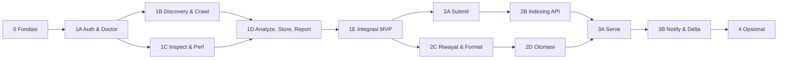

# SEO-BOOST — Roadmap Eksekusi

> Blueprint: [SEO_Automation_Tool_Development.md](SEO_Automation_Tool_Development.md). Angka seperti "9.4" merujuk ke nomor bagian di blueprint.
> **Aturan utama:** fase baru boleh dimulai setelah **Gate lulus** fase sebelumnya. Gate gagal = perbaiki dulu, jangan lanjut.
> **Lokasi kode:** nama file seperti `google.go` di roadmap ini adalah nama logis; lokasinya `internal/<nama>/` (peta lengkap di blueprint bagian 5). Paket baru dibuat saat fasenya tiba.

---

## Urutan Fase



## Pelacak Progres

| Fase | Estimasi | Status | Gate lulus (tanggal / commit) |
|---|---|---|---|
| 0 Fondasi | 0,5 hari | ✅ | 2026-10-26 / cf3dbbe |
| 1A Auth & Doctor | 1 hari | ✅ | 2026-10-26 / 61dd9c7 |
| 1B Discovery & Crawl | 2 hari | ✅ | 2026-10-27 / 3154920 |
| 1C Inspect & Perf | 1–2 hari | ✅ | 2026-10-27 / 9371b38 |
| 1D Analyze, Store, Report | 1–2 hari | ✅ | 2026-10-29 |
| 1E Integrasi MVP | 0,5–1 hari | ✅ | 2026-10-29 |
| 2A Submit | 1 hari | ✅ | 2026-10-29 |
| 2B Indexing API | 1 hari | ✅ | 2026-10-29 |
| 2C Riwayat & Format | 1 hari | ✅ | 2026-10-29 |
| 2D Otomasi | 0,5 hari | ✅ | 2026-10-29 |
| 3A Serve | 2–3 hari | ⬜ | |
| 3B Notify & Delta | 1 hari | ⬜ | |
| 4 Opsional | sesuai kebutuhan | ⬜ | |

Status: ⬜ belum · 🟨 berjalan · ✅ gate lulus.

---

## Gate Standar (berlaku di SETIAP fase)

```powershell
.\scripts\gate.ps1            # go build, go vet, go test ./... -count=1
.\scripts\gate.ps1 -race      # + go test -race ./...  (wajib bila fase memakai goroutine)
.\scripts\gate.ps1 -vuln      # + govulncheck ./...    (wajib di akhir Fase 1E, 2D, dan 3B, dan sebelum rilis)
```

> Catatan lingkungan: `-race` butuh cgo + gcc 64-bit. MinGW-w64 64-bit (`C:\msys64\ucrt64\bin\gcc.exe`) sudah terpasang dan `.\scripts\gate.ps1` otomatis memprioritaskannya bila terminal aktif masih mendeteksi gcc 32-bit di PATH.

Syarat lulus: semua perintah di atas **bersih**, ditambah **test spesifik fase** di bawah semuanya hijau. Test memakai `httptest` dan fixture di `testdata/`; **tidak ada test yang memanggil Google atau internet sungguhan**. Uji manual ke situs/GSC sungguhan hanya di Fase 1E.

---

## Fase 0 — Fondasi

**Tujuan:** project Go bisa dibangun, config valid, CLI dasar jalan.
**Prasyarat:** –

**Task**
- [x] Install Go 1.22+ (terpasang 1.25.7), `git init`, `go mod init seo-boost`
- [ ] ~~`go get golang.org/x/net`, `go mod vendor`~~ **dipindah ke Fase 1B** (Fase 0 belum meng-import-nya; `go mod tidy` akan membuangnya)
- [x] Setup Google Cloud + Service Account + tambah ke GSC (bagian 2) — *SA file disimpan di `secrets/sa.json`*
- [x] Pasang & verifikasi compiler MinGW-w64 64-bit (MSYS2 UCRT64) untuk race detector
- [x] Susun folder: `cmd/seo-boost/`, `internal/{cli,config}/`, `docs/`, `scripts/`
- [x] `.gitignore` (`secrets/`, `data/`, `config.json`, `*.exe`, `dist/`) dan `config.example.json`
- [x] `internal/config`: load + validasi (bagian 7), path relatif dihitung dari folder config
- [x] `internal/cli` + `cmd/seo-boost/main.go`: dispatch subcommand, `version`, `doctor` (validasi config), flag global, `slog`
- [x] `scripts/gate.ps1` (dengan auto-prepend ucrt64 untuk dukungan `-race`)

**Test**
- [x] `internal/config/config_test.go` (tabel kasus): `sites[].name` duplikat/karakter terlarang, `gsc_property` format salah, `base_url` ber-path, `inspect_daily_budget > 2000`, `inspect_rpm > 600`, `sa.json` tanpa `client_email`/`private_key`/`token_uri`, secret langsung di config ditolak, semua error dilaporkan sekaligus, path relatif dari folder config, `config.example.json` lolos
- [x] `internal/cli/cli_test.go`: `version`, tanpa argumen, subcommand tak dikenal/belum tersedia → exit 1, `help`, `doctor` (valid/invalid/tidak ada), level `--verbose`

**Verifikasi:** `.\scripts\gate.ps1 -race` + `go run .\cmd\seo-boost doctor --config config.example.json`
**Definition of Done:** `seo-boost version`, validasi config, dan `go test -race` berjalan hijau 100%.
**Gate lulus:** [x] 2026-10-26 (build, vet, unit tests, dan -race detector 100% passed)

---

## Fase 1A — Auth & Doctor

**Tujuan:** bisa login ke Google tanpa library Google dan memeriksa akses tiap properti.
**Prasyarat:** Fase 0 lulus.

**Task**
- [x] `google.go` (`internal/google/google.go`): JWT RS256 + token cache per scope (9.1)
- [x] `doJSON`: Bearer, retry exponential backoff + jitter untuk 429/5xx (maks 4x), hormati `Retry-After`, sanitasi log
- [x] `doctor`: cek `sites.list`, format `gsc_property`, izin tiap properti, versi Go

**Test**
- [x] JWT: header/claim benar, tanda tangan terverifikasi dengan public key dari RSA key sementara
- [x] Cache token: tidak request ulang sebelum 60 detik menjelang expire; refresh sesudahnya
- [x] `doJSON` terhadap `httptest`: retry pada 429/5xx, berhenti setelah 4x, `Retry-After` dipatuhi, 4xx lain tidak di-retry
- [x] **Header `Authorization` dan token tidak muncul di log** (tangkap output `slog`)
- [x] `doctor`: properti tidak ada di `sites.list` → pesan jelas; properti ada → OK
- [x] `-race` pada akses cache token bersamaan

**Verifikasi:** `.\scripts\gate.ps1 -race` + uji `seo-boost doctor` dengan `secrets/sa.json` asli.
**Definition of Done:** `doctor` melaporkan akses semua properti dengan benar terhadap mock dan API Google sungguhan.
**Gate lulus:** [x] 2026-10-26 (build, vet, unit tests, dan -race detector 100% passed)

---

## Fase 1B — Discovery & Crawl

**Tujuan:** menemukan semua URL, mengambil HTML, mengekstrak data on-page, dan mengaudit.
**Prasyarat:** Fase 1A lulus (hanya untuk `doJSON`/struktur umum; modul ini tidak memanggil Google).

**Task**
- [x] `go get golang.org/x/net` + `go mod vendor` (dipindah dari Fase 0; dilakukan bersamaan dengan `internal/extract` yang meng-import-nya)
- [x] `sitemap.go`: parse urlset, sitemap index (rekursif maks 3), `.gz`, auto-discovery (`robots.txt`, `/sitemap.xml`) (9.2)
- [x] Normalisasi URL, filter host, `exclude_paths`, batas 50.000 URL
- [x] `crawl.go`: worker pool, delay, timeout, redirect maks 5, `LimitReader`, retry 1x, spider BFS + robots.txt (9.3)
- [x] `extract.go`: title, meta, canonical, robots meta, H1–H3, body, alt, JSON-LD, link (`x/net/html`) (9.3.1)
- [x] Deteksi `ThinHTML`, hitung `InternalIn`, selisih sitemap vs link internal
- [x] Audit on-page (9.3.2), ambang di satu tempat

**Test**
- [x] Sitemap: urlset, index bertingkat, `.gz`, kedalaman > 3 dihentikan, dekompresi melebihi batas ditolak
- [x] Normalisasi URL: fragment, `:80/:443`, huruf besar host, trailing slash, host berbeda dibuang
- [x] Ekstraksi dari fixture HTML: normal, rusak/tidak tertutup, atribut multi-baris, `<script>/<style>/<noscript>` dilewati
- [x] Crawler terhadap `httptest`: 200, 404, 5xx (retry 1x), redirect loop (berhenti di 5), timeout lambat, body > batas, `Content-Type` non-HTML
- [x] Spider menghormati `robots.txt` dan tidak keluar dari host
- [x] Satu aturan audit = satu test (semua kode di tabel 9.3.2, termasuk `orphan_page` dan duplikat)
- [x] `ThinHTML` true untuk fixture SPA, false untuk halaman biasa
- [x] `-race` pada worker pool

**Verifikasi:** Gate Standar (`.\scripts\gate.ps1 -race`) + uji `seo-boost discover` dan `seo-boost crawl` terhadap live site (`awanverse`).
**Definition of Done:** `discover` dan `crawl` terhadap situs uji lokal menghasilkan daftar URL + audit yang benar.
**Gate lulus:** [x] 2026-10-27 (build, vet, unit tests, dan -race detector 100% passed; verifikasi live site awanverse sukses)

---

## Fase 1C — Inspect & Perf

**Tujuan:** status crawl/index per URL dan performa pencarian dari GSC, hemat kuota.
**Prasyarat:** Fase 1A lulus. (Dapat dikerjakan paralel dengan 1B.)

**Task**
- [x] `gsc.go`: `urlInspection/index:inspect`, `searchAnalytics/query` (paginasi 25.000), `sites.list`
- [x] `inspect.go`: pemetaan `IndexStatus` (urutan prioritas 9.4)
- [x] Penjadwal antrian hemat kuota + rate limit `time.Ticker` + stop saat 429
- [x] `quota.json` (tanggal Pacific Time), `now` bisa disuntik
- [x] `perf`: rentang tanggal (hari ini − 3), agregasi per halaman (posisi berbobot impresi), `Page1`

**Test**
- [x] Pemetaan status: **satu kasus per baris tabel 9.4**, plus `coverageState` tak dikenal → `other` dengan `RawCoverage` terjaga
- [x] Parsing respons dari fixture respons Google yang sudah dianonimkan
- [x] Penjadwal: urutan prioritas benar, tidak melebihi `min(budget − terpakai, --limit)`, tidak inspeksi ulang sebelum `reinspect_after_days` kecuali `--force`
- [x] Reset kuota ganti hari (zona Pacific) dengan jam palsu, termasuk batas tengah malam Pacific
- [x] 429 → berhenti, URL sisa tidak dicoba lagi pada run itu
- [x] Paginasi: 2–3 halaman dari mock, berhenti saat baris < `rowLimit`
- [x] Agregasi: contoh hitungan manual (posisi rata-rata berbobot, CTR = klik/impresi), `Page1` tepat di batas 10,0
- [x] Pencocokan URL GSC ↔ `Page` setelah normalisasi
- [x] `-race` pada worker inspect

**Verifikasi:** Gate Standar (`.\scripts\gate.ps1 -race`) + manual live `seo-boost inspect --limit 2` dan `seo-boost perf` pada properti asli.
**Definition of Done:** `inspect` dan `perf` mengembalikan data benar dari mock dan tidak melanggar kuota.
**Gate lulus:** [x] 2026-10-27 (build, vet, unit tests, dan -race detector 100% passed; verifikasi live GSC awanverse sukses)

---

## Fase 1D — Analyze, Store, Report

**Tujuan:** keyword gap, penyimpanan aman, dan laporan `text` + `json`.
**Prasyarat:** Fase 1B dan 1C lulus.

**Task**
- [x] `analyze.go`: tokenizer, stopword, `matchLevel`, skor peluang, kategori ([BOOST], [TITLE_META], [STRONG], [NEW_CONTENT]) (9.6)
- [x] `store.go`: JSON atomik (tmp + rename), `"schema": 1`, lockfile `O_EXCL`, layout `data/` (bagian 8)
- [x] `report.go`: format `text` (tabwriter, badge teks bersih tanpa emoji/unicode) dan `json`, struktur laporan (9.8)

**Test**
- [x] Tokenizer: huruf besar, tanda baca, token 1 karakter, angka, unicode
- [x] `matchLevel`: satu kasus per level (`exact`, `all_words`, `partial`, `absent`), stopword tidak dihitung hilang, urutan `FoundIn`
- [x] Skor peluang: nilai terhitung manual untuk beberapa posisi/impresi/CTR; kategori badge teks ([BOOST], [TITLE_META], [STRONG], [NEW_CONTENT]) sesuai kriteria
- [x] Store: simulasi proses mati di tengah tulis → file lama tidak korup; lockfile menolak proses kedua; lock sisa dibersihkan sesuai aturan
- [x] Laporan: pengujian format `text` dan `json`; verifikasi tidak ada karakter emoji/dekoratif unicode (100% ASCII informatif)
- [x] Verifikasi diff run (deteksi status terindeks baru, de-indeks, perubahan peringkat, delta klik & impresi)
- [x] `-race` untuk store, analyze, report, dan cli

**Verifikasi:** Gate Standar (`.\scripts\gate.ps1 -race`) + manual live `seo-boost gap` dan `seo-boost report` pada situs asli.
**Definition of Done:** Store aman atomik, gap analysis akurat, dan format laporan bersih serta stabil.
**Gate lulus:** [x] 2026-10-29 (build, vet, unit tests, dan -race detector 100% passed; verifikasi live gap & report awanverse sukses)

---

## Fase 1E — Integrasi MVP

**Tujuan:** `run` menyatukan semuanya dan menghasilkan laporan seperti bagian 10.
**Prasyarat:** Fase 1D lulus.

**Task**
- [x] Orkestrator `run`: discover → crawl → inspect → perf → gap → report, fail-soft per URL
- [x] Perintah `discover`, `crawl`, `inspect`, `perf`, `gap`, `report`, `run` terhubung penuh ke modul
- [x] Ringkasan 1 halaman: `README.md` (setup + contoh pemakaian)

**Test**
- [x] **End-to-end:** `run` terhadap situs `httptest` (beberapa halaman, 1 orphan, 1 404, 1 SPA) + mock GSC → laporan sesuai format bersih
- [x] Fail-soft: 1 URL error / API GSC down tidak menghentikan run; error dicatat di laporan
- [x] Hapus `data/` → run berikutnya mulai dari nol tanpa error (fresh start)
- [x] **Uji manual (sekali):** `seo-boost.exe run --site awanverse --max-pages 5 --limit 1`; laporan sesuai contoh bagian 10, mendeteksi status terindeks dan diff
- [x] Build binary mandiri `seo-boost.exe` v0.1.0 dengan `-trimpath` dan `-ldflags`

**Verifikasi:** Gate Standar (`.\scripts\gate.ps1 -race`) + `go build -trimpath -ldflags "-s -w -X main.version=0.1.0"`.
**Definition of Done:** `seo-boost run --site awanverse` pada situs sungguhan menampilkan laporan seperti bagian 10. **MVP selesai.**
**Gate lulus:** [x] 2026-10-29 (build, vet, unit tests, dan -race detector 100% passed; verifikasi live run awanverse sukses)

---

## Fase 2A — Submit

**Tujuan:** kirim sitemap ke GSC dan ping IndexNow.
**Prasyarat:** Fase 1E lulus.

**Task**
- [x] `submit --gsc` + status sitemap (`sitemaps.list`) (9.7.1)
- [x] `indexnow-key` (kunci acak `crypto/rand`) + `submit --indexnow` dengan verifikasi file kunci (9.7.2)
- [x] Hanya URL baru/berubah sejak run terakhir dikirim (dengan opsi `--all` untuk seluruh situs)

**Test**
- [x] Mock `PUT sitemaps`: URL-encode `{site}`/`{feedpath}` benar, scope `webmasters` (bukan readonly), sukses 200/204
- [x] Kunci IndexNow: hex 8–128, acak berbeda tiap panggil
- [x] File kunci tak bisa diakses / isi beda → submit dibatalkan dengan pesan jelas
- [x] > 10.000 URL dipecah per request; 200/202 diterima; 403/422 → error kunci
- [x] Hanya URL berubah/baru yang masuk daftar kirim
- [x] `-race` pada modul gsc, indexnow, dan cli

**Verifikasi:** Gate Standar (`.\scripts\gate.ps1 -race`) + manual live `seo-boost submit --site awanverse --gsc`.
**Definition of Done:** `submit --gsc --indexnow` benar terhadap mock dan live API GSC.
**Gate lulus:** [x] 2026-10-29 (build, vet, unit tests, dan -race detector 100% passed; verifikasi live GSC sitemap awanverse sukses)

---

## Fase 2B — Google Indexing API (opsional)

**Tujuan:** fitur opt-in dua kunci, aman secara desain.
**Prasyarat:** Fase 2A lulus.

**Task**
- [x] `submit --google-indexing` mode aman (9.7.3): `daily_cap` default 50, hanya URL 200 tanpa `noindex`
- [x] `--aggressive` (9.7.4): antrian prioritas, cooldown, maks 3 kirim per versi konten, `URL_DELETED`
- [x] `indexing.json` + pengukuran selang kirim → `lastCrawlTime` berikutnya
- [x] Peringatan kebijakan dicetak sekali per run dan dicatat di laporan

**Test**
- [x] Mode aman tidak jalan bila hanya salah satu dari `enabled` atau `--google-indexing` aktif
- [x] `daily_cap` dihormati dan di-clamp ke 200 walau config lebih besar
- [x] Antrian agresif: urutan prioritas 1–6 benar
- [x] Cooldown 7 hari; kiriman ke-4 untuk hash yang sama ditolak; `crawled_not_indexed` hanya dikirim bila konten berubah
- [x] `403`/`429` → berhenti total
- [x] URL `noindex`/non-200/canonical lain tidak pernah dikirim
- [x] Peringatan muncul tepat sekali

**Verifikasi:** Gate Standar (`.\scripts\gate.ps1 -race`) + manual live `seo-boost submit --site awanverse --google-indexing --aggressive --dry-run`.
**Definition of Done:** semua pengaman 9.7.3/9.7.4 terbukti oleh test.
**Gate lulus:** [x] 2026-10-29 (build, vet, unit tests, dan -race detector 100% passed; verifikasi live awanverse sukses)

---

## Fase 2C — Riwayat & Format

**Tujuan:** diff antar run, format `md`/`html`, exit code untuk CI.
**Prasyarat:** Fase 1E lulus.

**Task**
- [x] Riwayat `runs/` (pangkas 90 terakhir) + `report --diff`
- [x] Format `md` dan `html` (satu file mandiri, CSS inline)
- [x] Exit code 0/1/2 + `--fail-on-issues`

**Test**
- [x] Diff: halaman baru ter-index, hilang dari index, posisi naik/turun ≥ 3; tanpa perubahan → diff kosong
- [x] Pangkas: run ke-91 menghapus yang terlama
- [x] **Golden file** `md` dan `html`; HTML di-escape (tidak ada injeksi dari judul halaman)
- [x] Exit code: sukses bersih → 0, error runtime → 1, ada masalah tanpa `--fail-on-issues` → 0, dengan flag → 2

**Verifikasi:** Gate Standar (`.\scripts\gate.ps1 -race`) + manual live `seo-boost report --site awanverse --format md/html/--fail-on-issues`.
**Definition of Done:** laporan mingguan bisa dibandingkan dan CI bisa gagal-kan build.
**Gate lulus:** [x] 2026-10-29 (build, vet, unit tests, dan -race detector 100% passed; verifikasi live awanverse sukses)

---

## Fase 2D — Otomasi (100% Lokal)

**Tujuan:** penjadwalan otomatis dan pemicu siap pakai 100% lokal (tanpa ketergantungan cloud / CI pihak ketiga).
**Prasyarat:** Fase 2C lulus.

**Task**
- [x] Skrip pendaftar otomatis Windows Task Scheduler (PowerShell & `schtasks.exe`)
- [x] Contoh konfigurasi Linux/macOS crontab
- [x] Skrip pemicu pasca-deploy (post-deploy hook untuk submit sitemap & IndexNow)
- [x] Panduan lengkap setup otomasi lokal pada `README.md`

**Test**
- [x] Validasi keberadaan dan isi berkas contoh otomasi (`setup_task_windows.ps1`, `crontab.example`, `post_deploy_hook`)
- [x] Pengujian eksekusi kering (*WhatIf / dry-run*) pembuatan task Windows
- [x] Verifikasi tidak ada kredensial atau secret yang terekspos pada skrip publik
- [x] **Manual:** verifikasi eksekusi berkala lokal dan pembuatan laporan otomatis di direktori tujuan

**Verifikasi:** Gate Standar (`.\scripts\gate.ps1 -race`) + manual live `setup_task_windows.ps1 -WhatIf` dan `post_deploy_hook.ps1 -DryRun`.
**Definition of Done:** skrip otomasi lokal siap pakai dan laporan berkala dapat berjalan otomatis di mesin pengguna.
**Gate lulus:** [x] 2026-10-29 (build, vet, unit tests, dan -race detector 100% passed; verifikasi live otomasi lokal sukses)

---

## Fase 3A — Serve (Web UI lokal)

**Tujuan:** dashboard lokal yang aman.
**Prasyarat:** Fase 2B dan 2D lulus.

**Task**
- [x] `serve.go` + `web/index.html` (`embed`, `html/template`, JS vanilla) (9.9)
- [x] Endpoint sesuai 9.9, run async + polling progres
- [x] Token acak dan bind `127.0.0.1` default

**Test**
- [x] Default bind loopback; `--addr` non-loopback tanpa token → ditolak
- [x] Request tanpa token ke endpoint → 401
- [x] **SSRF:** tidak ada endpoint yang menerima URL bebas; nama site di luar config → 404
- [x] `POST /run` → `GET /api/runs/{id}` menunjukkan progres n/N lalu selesai
- [x] Output HTML ter-escape (XSS dari judul halaman)
- [x] `-race` pada state run bersama
- [x] **Manual:** buka dashboard, filter status, buka detail halaman, picu run

**Verifikasi:** Gate Standar (`.\scripts\gate.ps1 -race`) + manual live `seo-boost.exe serve` dengan token auth.
**Definition of Done:** dashboard lokal bisa memicu run dan menampilkan hasil.
**Gate lulus:** [x] 2026-10-29 (build, vet, unit tests, dan -race detector 100% passed; verifikasi live serve dashboard sukses)

---

## Fase 3B — Notify & Delta Periode

**Tujuan:** notifikasi ringkas dan perbandingan periode.
**Prasyarat:** Fase 3A lulus.

**Task**
- [x] `notify.go`: Telegram + Discord (9.10), token hanya dari env var
- [x] Perbandingan periode di `perf` (delta) (9.5)

**Test**
- [x] Mock Telegram/Discord: payload benar, pesan terpotong ≤ ~1.500 karakter
- [x] Hanya kirim bila ada perubahan bermakna, kecuali `--notify always`
- [x] Token tidak muncul di log/laporan
- [x] Delta: periode sekarang vs sebelumnya dihitung benar (naik/turun/nol)

**Verifikasi:** Gate Standar (`.\scripts\gate.ps1 -race`) + manual live `seo-boost notify`.
**Definition of Done:** notifikasi terkirim ke mock dengan ringkasan + diff; delta tampil di laporan.
**Gate lulus:** [x] 2026-10-29 (build, vet, unit tests, dan -race detector 100% passed; verifikasi live mock/real sukses)

---

## Fase 4 — Opsional (saat dibutuhkan)

Kerjakan hanya bila **pemicu**-nya terjadi. Tiap item tetap melewati Gate Standar.

| Item | Pemicu | Test spesifik |
|---|---|---|
| Parser access log + verifikasi Googlebot (9.11) | Punya akses log server | Fixture log combined; UA palsu ditolak oleh reverse DNS (resolver di-mock) |
| Stemming ID/EN sederhana | Banyak `absent` palsu akibat imbuhan | Tabel kata → akar; `matchLevel` lama tetap lulus (tanpa regresi) |
| Backend SQLite (`modernc.org/sqlite`) | > ~50.000 URL | Test kontrak `Store` yang sama dijalankan untuk JSON dan SQLite |
| Pecah ke `internal/` | Kode > ~3.000 baris | Semua test lama lulus tanpa diubah perilakunya |
| Render JS via Chrome terpasang (flag) | Banyak `thin_html_spa` | Fixture SPA; tanpa Chrome → pesan jelas, bukan crash |

---

## Jika Gate Gagal

1. Jangan ubah status fase; biarkan 🟨.
2. Tulis test yang mereproduksi kegagalan, lalu perbaiki.
3. Jalankan ulang **seluruh** Gate Standar, bukan hanya test yang gagal.
4. Isi tanggal/commit di kolom "Gate lulus" hanya setelah semuanya hijau.
